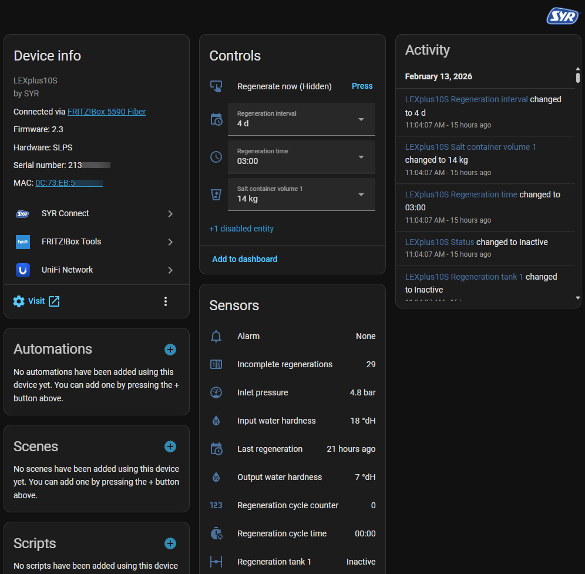
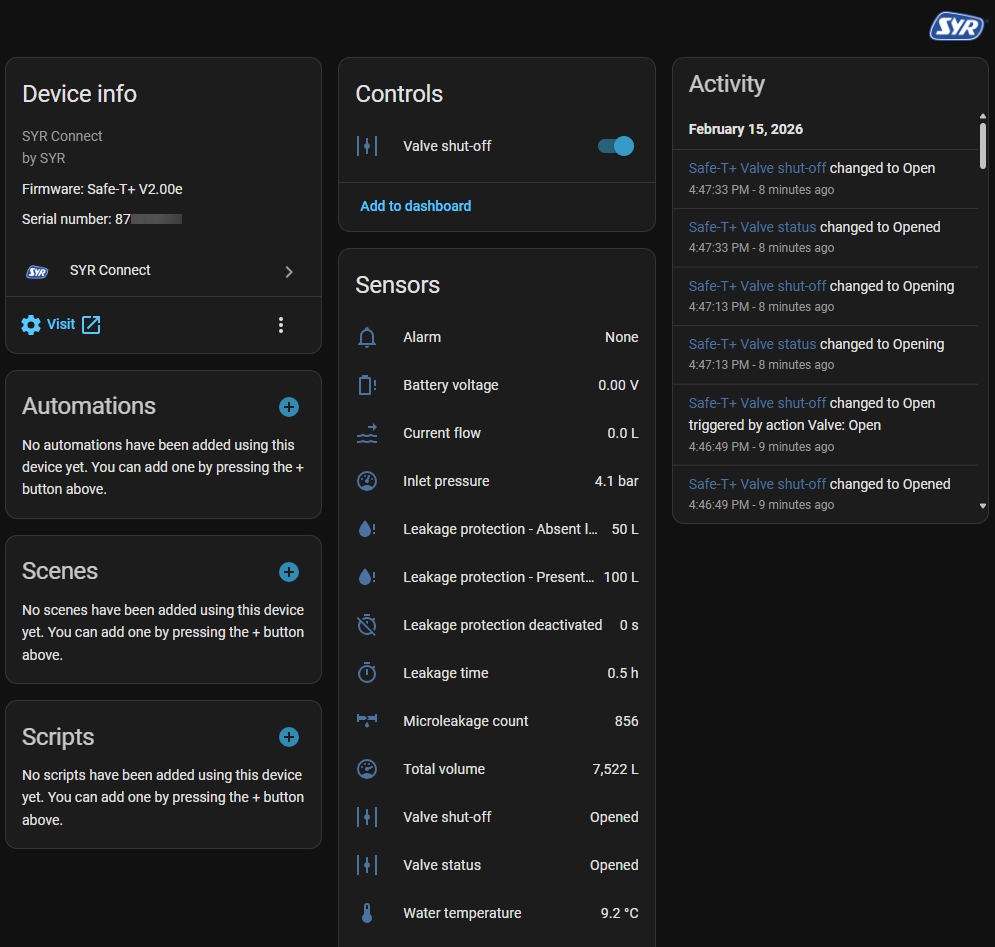

<!-- markdownlint-disable-next-line MD041 -->


# SYR Connect - Home Assistant-Integration

[](https://github.com/alexhass/syr_connect/releases)
[](https://my.home-assistant.io/redirect/config_flow_start/?domain=syr_connect)
[](https://github.com/alexhass/syr_connect/blob/main/quality_scale.yaml)

[](https://github.com/alexhass/syr_connect/actions/workflows/hassfest.yaml)
[](https://github.com/alexhass/syr_connect/actions/workflows/hacs.yaml)
[](https://github.com/alexhass/syr_connect/actions/workflows/ci.yml)
[](https://codecov.io/gh/alexhass/syr_connect)

Diese Custom-Integration ermöglicht die Steuerung von SYR Connect-Geräten über Home Assistant. Des Weiteren kann diese Integration auch für die baugleichen Geräte anderer Marken genutzt werden. Gemischte Installationen unterschiedlicher Marken werden ebenfalls unterstützt.

| Marke | Link |
| ------ | ------ |
| comfort by sanibel | <https://comfort-by-sanibel.de/> |
| CONEL | <https://www.conel.de/> |
| DITECH | <https://www.ditech-haustechnik.de/> |
| Hansgrohe Pontos | <https://www.hansgrohe.de/> |
| mein concept | <https://www.mein-concept.de/> |
| mein Optima | <https://www.mein-optima.de/> |
| POLYGONVATRO | <https://www.polygongroup.com/de-DE/> |
| Reliance Valves | <https://www.rwc.com/brands/reliance-valves> |
| SYR | <https://www.syr.de/> |
| SYR Oceanic | <https://www.debestewaterbehandeling.be/> |
| TAKE | <https://take-bad.de/> |

## Screenshots

Beispiele der Geräteoberflächen:





## Installation

[](https://my.home-assistant.io/redirect/marketplace_repository/?owner=alexhass&repository=syr_connect&category=integration)

### Marketplace (empfohlen)

1. Einstellungen > Marketplace öffnen.
2. Nach „SYR Connect“ suchen.
3. „Installieren“ auswählen.
4. Home Assistant neu starten.

### Manuelle Installation

1. Den Ordner `syr_connect` in das Verzeichnis `custom_components` kopieren.
2. Home Assistant neu starten.

## Konfiguration

[](https://my.home-assistant.io/redirect/config_flow_start/?domain=syr_connect)

Die Integration unterstützt zwei Konfigurationsmodi:

### Einrichtung der Cloud-API (Alle Geräte)

1. Einstellungen > Geräte & Dienste öffnen.
2. „+ Integration hinzufügen“ auswählen.
3. Nach „SYR Connect“ suchen.
4. „Cloud“ auswählen.
5. Die Zugangsdaten der App eingeben:
   - **Dienst**: Die App, in der die Geräte eingerichtet sind
   - **Benutzername**: Benutzername des Kontos in dieser App
   - **Passwort**: Passwort des Kontos in dieser App

### Einrichtung der lokalen API (Nur neuere Geräte)

Für neuere Geräte mit lokaler JSON-API, zum Beispiel die NeoSoft- und Trio-Geräte, SafeTech Lock, TRIO Lock, AC 3200 und RSA Connect und ihre baugleichen Geräte anderer Marken. Die Modellauswahl in der Einrichtung zeigt alle unterstützten Modelle:

1. Einstellungen > Geräte & Dienste öffnen.
2. „+ Integration hinzufügen“ auswählen.
3. Nach „SYR Connect“ suchen.
4. „Lokal“ auswählen.
5. Die Geräteinformationen eingeben:
   - **Gerätemodell**: Modell des Geräts (z. B. NeoSoft 2500 Connect)
   - **Host**: IP-Adresse oder Hostname des Geräts (z. B. `192.168.178.199`)

**Hinweis**: Die IP-Adresse des Geräts steht in der DHCP-Client-Liste des Routers oder im Display-Menü des Geräts.

**Wichtig**: Für einen stabilen Betrieb muss das Gerät eine **statische IP-Adresse** oder eine **reservierte DHCP-Adresse** (DHCP-Reservierung) haben. Ändert sich die IP-Adresse des Geräts, verliert die Integration die Verbindung. Die neue Adresse wird über „Neu konfigurieren“ im Drei-Punkte-Menü (⋮) des Eintrags eingegeben. Alternativ kann ein Hostname verwendet werden, wenn das Netzwerk lokale DNS-Auflösung unterstützt.

## Funktionen

Die Integration erstellt automatisch Entitäten für alle SYR Connect-Geräte des Kontos.

### Unterstützte Geräte

Diese Integration funktioniert mit SYR-Wasserenthärtern, Leckage-Erkennungsgeräten und anderen, die im SYR Connect-Cloud-Portal (über die jeweilige App) sichtbar sind.

Getestet und gemeldet als funktionierend:

- CONEL CLEAR PRO Bodensensor
- CONEL CLEAR PRO FILL
- CONEL CLEAR PRO LEAKAGE PROTECTION
- CONEL CLEAR PRO SOFT
- concept SafeFloor Bodensensor
- DITECH Funk-Bodensensor
- Optima T2 Bodensensor
- POLYGONVATRO Funk-Bodensensor
- Sanibel Funk-Bodensensor A25
- Sanibel Leckageschutzmodul A25
- Sanibel Softwater UNO A25
- SYR LEX 1500 Connect Einzel (LEX10/LEX20/LEX30/LEX40/LEX60/LEX80/LEX100)
- SYR LEX Plus 10 Connect
- SYR LEX Plus 10 S Connect
- SYR LEX Plus 10 SL Connect
- SYR NeoSoft 2500 Connect
- SYR SafeFloor Connect
- SYR Safe-T+ Connect
- SYR SafeTech Connect
- SYR SafeTech plus Connect
- SYR SafeTech V3 Connect
- SYR SafeTech V4 Connect
- SYR TRIO DFR/LS Connect 2425
- SYR TRIO Lock Connect
- SYR Oceanic i-LEX / Limex iQ Einzel (L10/L12/L15/L20/L25/L30/L40/L50/L60/L70/L80/L90/L100)

Andere Geräte sind auch interessant, müssen aber noch integriert oder zumindest getestet werden (bitte melden):

- CONEL CLEAR PRO MULTICONTROL-KIT
- CONEL CLEAR PRO SOFT TWIN
- concept 200 Doppelenthärtungsanlage
- concept 200 Ersatzfilter
- concept 300 Rückspülautomatik RSA
- concept 300 Triofilter mit Leckageschutz
- concept Doppelenthärtungsanlage
- concept Einzelenthärtungsanlage
- DITECH Anschlussmodul Plus
- DITECH Doppelenthärtungsanlage
- DITECH Einzelenthärtungsanlage
- DITECH Hygienespülbox
- DITECH Rückspülautomatik HWS/RF
- DITECH Rückspülfilter Protect
- Hansgrohe PontosBase
- Optima Doppelenthärtungsanlage
- Optima Einzelenthärtungsanlage
- Optima T Ersatzfilter
- Optima T2 Doppelenthärtungsanlage
- POLYGONVATRO SafeTech Connect (über die AXA Gebäudeversicherung als „Wasserwächter“ vertrieben)
- RWC MultiSafe Floor Leak Sensor
- RWC MultiSafe Leak Detector Control Valve
- Sanibel Automatische Rückspülanlage RSA A25
- Sanibel Softwater DUO A25
- SYR AC 3200 Connect
- SYR AC All-in-One 3228 Connect
- SYR All in One +
- SYR CONTROLICmini
- SYR HVA
- SYR HygBox Connect
- SYR Hygienemodul (kalt / warm / kalt und warm)
- SYR Inliner-HWA 3300
- SYR IT 3000 Pendelanlage
- SYR LEX 1500 Connect Doppel
- SYR LEX 1500 Connect Dreifach
- SYR LEX 1500 Connect Pendel
- SYR NeoDos Connect
- SYR NeoSoft 5000 Connect
- SYR NeoSoft Lock Connect I / II
- SYR RSA Connect
- SYR Safe-T Kommunikationsmodul
- SYR Safe-T Master / Slave
- SYR SafeTech Lock Connect
- SYR Trio LS Connect
- TAKE Doppelenthärtungsanlage
- TAKE Einzelenthärtungsanlage
- Andere SYR-Modelle mit Connect-Funktion oder nachgerüstetem Gateway

**Hinweis**: Wenn ein Gerät im SYR Connect-Konto sichtbar ist, entdeckt die Integration es automatisch und erstellt die Entitäten. Bei einem „ungetesteten Gerät“ helfen die geteilten Diagnosedaten, unbekannte Werte zu analysieren und die Liste getesteter Geräte zu erweitern.

### Nicht unterstützte Geräte

- SYR Oceanic Limex SMART COMPACT/MINI/MAXI-Geräte. Diese Geräte nutzen statt des SYR Connect-Cloud-Dienstes ein anderes Cloud-Portal (`i-lexconnect.com`). Es handelt sich hierbei um umbenannte Husty SaoCal-Geräte.
- Husty SaoCal-Geräte. Siehe [husty_integration_home_assistant](https://github.com/trafopowielacz/husty_integration_home_assistant).

### Unterstützte Funktionen

#### Sensoren

Die Integration bietet eine umfangreiche Überwachung der Geräte:

#### Wasserqualität & Kapazität

- Überwachung Roh-/Weichwasserhärte
- Wasserleitfähigkeit (µS/cm)
- Wasserhärtebereich (weich, mittel, hart), geschätzt aus der Leitfähigkeit (SafeTech-Familie)
- Leitfähigkeitsfaktor
- Wassertemperatur (°C)
- Verbleibende Enthärtekapazität
- Harzkapazität je Behälter (bis zu 3 Behälter, %)
- Gesamtvolumen
- Anzeige der Einheit der Wasserhärte

#### Regenerationsinformationen

- Regenerationsstatus und aktiver Behälter (bis zu 3 Behälter)
- Regenerationsmodus (Standard / ECO / Power / Automatisch)
- Anzahl durchgeführter Regenerationen
- Zeitpunkt der letzten Regeneration
- Einstellung des Regenerationsintervalls
- Regenerationszeitplan
- Zähler und Zeitangaben für Regenerationszyklen

#### Salzverwaltung

- Salzmenge in Behältern (1–3)
- Salzvorrat (verbleibende Wochen)
- Reservekapazität je Flasche

#### Systemüberwachung

- Wasserdrucküberwachung
- Durchflussrate (aktuell und Momentanwert)
- Durchflusszähler (Gesamtverbrauch)
- Batterie- und Netzspannung
- Alarm-, Benachrichtigungs- und Warnstatus (aktueller Code und letzte 8 Einträge)

#### Leckageschutz (LEXplus10SL / Trio DFR/LS)

- Volumen- und Zeitgrenzwerte für den Leckageschutz (Anwesend- und Abwesendprofil)
- Index des aktiven Leckageschutz-Profils
- Leckageschutz-Profile 1–8 (Volumenlimit, maximale Dauer, Durchflussschwelle, Warn- und Signalton-Flags)
- Timer für temporäre Deaktivierung
- Leckage-Warnschwellwert (%)

#### Mikroleckage-Test (Trio DFR/LS, SafeTech, SafeTech+, TRIO Lock, SafeTech Lock)

- Intervall und Status des Mikroleckage-Tests
- Testdauer und Ereigniszähler

#### Selbstlernphase (Trio DFR/LS, SafeTech+, TRIO Lock, SafeTech Lock)

- Verbleibende und abgelaufene Zeit der Selbstlernphase
- Durchflussrate und kumuliertes Volumen während der Selbstlernphase
- Einstellungen der Selbstlernphase: Zuschlag für Volumen und Zeit, Zuschlag für Durchfluss, Mindestdurchfluss

#### Bodensensor (SafeFloor)

- Aktuelle Luftfeuchtigkeit und Temperatur
- Batteriestand (%)
- Alarmstatus

#### Filter (NeoSoft)

- Rückspülzähler des Filters
- Filtertyp
- Eisengehaltsmessung

#### Wartung

- Nächste geplante Wartungstermine (halbjährlich und jährlich)
- Erwarteter täglicher Wasserverbrauch

#### Geräteinformationen

- Seriennummer
- Firmware-Version und Modell
- Gerätetyp und Hersteller
- Netzwerk-Informationen (IP, MAC, Gateway)
- WLAN-Verbindungsstatus und Signalstärke
- Zeitzone (UTC-Abweichung)

#### Binärsensoren

- **Signalton bei Alarm**: Zeigt an, ob bei einem Alarm ein Signalton ertönt.
- **Leckageschutz**: Zeigt an, ob der Leckageschutz aktiv oder deaktiviert ist.
- **Ventiltest**: Zeigt an, ob gerade ein Ventiltest läuft.
- **Firmware-Prüfung**: Zeigt an, ob eine neue Firmware verfügbar ist (geprüft beim Start und alle 6 Stunden).
- **Sommerzeit**: Zeigt an, ob das Gerät automatisch auf Sommerzeit umstellt.
- **Temperatursensor**, **Drucksensor**, **Leitfähigkeitssensor**: Zeigen an, ob der Messsensor aktiv oder deaktiviert ist.
- **Bodensensor-Überwachung**: Zeigt an, ob die Überwachung der Bodensensoren aktiviert ist.

#### Buttons (Aktionen)

- **Sofort regenerieren**: Sofortige Regeneration starten.
- **Alarm zurücksetzen**: Aktive Alarmmeldungen löschen.
- **Benachrichtigung zurücksetzen**: Benachrichtigungen löschen.
- **Warnung zurücksetzen**: Warnungen löschen.
- **Mikroleckage-Test starten**: Mikroleckage-Test starten. Das Ventil bleibt dabei etwa 4 Minuten geschlossen, eine Wasserentnahme während des Tests führt zu einem negativen Ergebnis (nur lokale API).

#### Schalter

- **Signalton bei Alarm**: Signalton bei Alarm aktivieren oder deaktivieren.
- **Profilwechsel am Gerät erlauben**: Wechsel des Leckageschutz-Profils mit der Taste am Gerät erlauben oder sperren.
- **Füllmodus**: Automatische Befüllung aktivieren oder deaktivieren (CLEAR PRO FILL All-in-One, AC All-in-One 3228 Connect).
- **Automatische Rückspülung**: Automatische Rückspülung aktivieren oder deaktivieren (Rückspülautomatik RSA).
- **Rückspülerinnerung**: Erinnerung an die Rückspülung aktivieren oder deaktivieren (Rückspülautomatik RSA).

#### Auswahlfelder (Konfiguration)

- **Regenerationsuhrzeit**: Tägliche Uhrzeit der Regeneration einstellen (15-Minuten-Intervalle).
- **Aktives Leckageschutz-Profil**: Aktives Leckageschutz-Profil auswählen (bei Geräten mit mehreren Profilen).
- **Salzmenge in Behälter 1–3**: Salzmenge je Behälter einstellen (je nach Modell, bis zu 3 Behälter).
- **Regenerationsintervall**: Regenerationshäufigkeit einstellen (modellabhängig: 1–4 Tage).
- **Display-Orientierung**: Ausrichtung des Displays einstellen (0 / 90 / 180 / 270 Grad, für Geräte mit Display).
- **Regenerationsmodus**: Standard / ECO / Power / Automatisch auswählen (für Geräte, die dies unterstützen).
- **Rohwasserhärte**, **Weichwasserhärte**: Rohwasser- und Weichwasserhärte einstellen (nur LEX-Familie). Die Einheit folgt der am Gerät eingestellten Härteeinheit (°dH, °fH, °e, mg/l CaCO₃, ppm, mmol/l oder mval/l).
- **Wasseraufbereitung und Befüllung** (CLEAR PRO FILL All-in-One, AC All-in-One 3228 Connect): Kartuschengröße und -typ, Weichwasserhärte oder maximale Ausgangsleitfähigkeit (je nach Kartusche), Zeitraum der Füllungen, Anzahl der Füllzyklen, maximale Fülldauer und -menge, Solldruck.
- **Bodensensor** (SafeFloor): Alarmdauer, minimale und maximale Schwellwerte für Luftfeuchtigkeit und Temperatur („Aus“ deaktiviert einen Schwellwert), Messintervall und Synchronisationsintervall der Einstellungen.

#### Ventilsteuerung

- **Ventilabsperrung**: Steuerung des Haupt-Absperrventils.
  - Ventil öffnen und schließen.
  - Aktuelle Ventilposition und Status überwachen.
  - Integration mit Leckerkennungs-Automatisierungen für automatisches Absperren.

#### Firmware-Update

- **Firmware-Update**: Zeigt an, ob eine neue Firmware verfügbar ist, und installiert sie. Das Gerät muss mit dem Internet verbunden sein. Die Nummer der neuen Version meldet das Gerät nicht.

### API-Modi

Die Integration unterstützt zwei API-Modi:

#### Cloud-API (XML-basiert)

- **Unterstützt von**: Allen SYR Connect-Geräten
- **Verbindung**: Über den SYR Connect-Cloud-Dienst
- **Authentifizierung**: Benutzername und Passwort vom SYR Connect-Konto
- **Vorteile**: Funktioniert mit allen Gerätemodellen, Fernzugriff von überall
- **Voraussetzungen**: Internetverbindung, SYR Connect-Konto

#### Lokale API (JSON-basiert)

- **Unterstützt von**: Neueren Modellen mit integrierter lokaler API, zum Beispiel NeoSoft, Trio DFR/LS, TRIO Lock, SafeTech Lock, AC 3200, RSA, Pontos Base, All in One +, HygBox und neueren SafeTech-Varianten, auch von anderen Marken. Die Modellauswahl in der Einrichtung zeigt alle unterstützten Modelle.
- **Verbindung**: Direkt zum Gerät über lokales Netzwerk (Port 5333).
- **Authentifizierung**: Keine Zugangsdaten erforderlich.
- **Vorteile**: Keine Internetabhängigkeit, schnellere Reaktionszeiten, keine Cloud-Rate-Limits.
- **Voraussetzungen**: Gerät muss im selben Netzwerk wie Home Assistant sein, Gerät benötigt statische IP-Adresse oder Hostnamen.

Die Integration erkennt automatisch, welcher API-Modus basierend auf der bei der Einrichtung angegebenen Konfiguration zu verwenden ist.

## Aktualisierung der Daten

Die Integration fragt die Geräte-API in regelmäßigen Abständen ab (Standard: 60 Sekunden). Der Aktualisierungsprozess hängt vom API-Modus ab:

### Aktualisierung über die Cloud-API

1. **Anmeldung**: Authentifiziert sich mit den Zugangsdaten bei der SYR Connect-Cloud-API.
2. **Geräteerkennung**: Ruft alle Projekte und Geräte ab, die mit dem Konto verknüpft sind.
3. **Statusabfrage**: Holt für jedes Gerät die aktuellen Statuswerte.
4. **Aktualisierung der Entitäten**: Aktualisiert alle Home Assistant-Entitäten mit den neuesten Werten.

### Aktualisierung über die lokale API

1. **Statusabfrage**: Holt den Gerätestatus direkt vom lokalen Endpunkt.
2. **Aktualisierung der Entitäten**: Aktualisiert alle Home Assistant-Entitäten mit den neuesten Werten.

Die lokale API ist schneller und benötigt keine Internetverbindung, was sie zuverlässiger für Echtzeit-Überwachung und Automatisierungen macht.

Schlägt eine Aktualisierung vorübergehend fehl (z. B. Zeitüberschreitung, Wartung der Cloud oder eine unvollständige Antwort), behalten die Entitäten ihre letzten Werte, und der Fehler wird ins Protokoll geschrieben. Nicht verfügbar werden die Entitäten nur, wenn die Cloud das Gerät als offline meldet. Sie bleiben nicht verfügbar, bis das Gerät wieder einen vollständigen Status sendet.

### SafeFloor-Messverlauf

Ein SafeFloor misst Temperatur und Luftfeuchtigkeit regelmäßig, sendet seine Messungen aber nur alle paar Tage an die Cloud. Seine Sensoren zeigen deshalb eine flache Linie und dann einen Sprung. Die Integration holt die einzelnen Messungen alle 12 Stunden aus der Cloud und speichert sie als Statistiken, die wie die Sensoren heißen (z. B. „Hauswirtschaftsraum Temperatur“). Für die echte Kurve eine Karte in einem Dashboard anlegen:

1. Das Dashboard öffnen und oben rechts **Dashboard bearbeiten** wählen.
2. **Karte hinzufügen** wählen, in **Karten durchsuchen** `Statistik` eintippen und **Statistikdiagramm** wählen.
3. **Code-Editor anzeigen** wählen, den Text durch einen der Ausschnitte unten ersetzen und **Speichern** wählen.
4. **Fertig** wählen.

`123456789` durch die Seriennummer des SafeFloor ersetzen. Je Messwert wird eine Karte benötigt.

Temperatur:

```yaml
type: statistics-graph
title: Temperatur
chart_type: line
period: hour
days_to_show: 14
stat_types:
  - mean
entities:
  - syr_connect:123456789_getcel_history
```

Luftfeuchtigkeit:

```yaml
type: statistics-graph
title: Luftfeuchtigkeit
chart_type: line
period: hour
days_to_show: 14
stat_types:
  - mean
entities:
  - syr_connect:123456789_gethmd_history
```

Die Cloud hält nur die Messungen der letzten 6 Tage vor. Das Synchronisationsintervall des Sensors sollte deshalb höchstens 6 Tage betragen, sonst gehen Messungen verloren. Die Statistiken werden zusammen mit dem Gerät gelöscht.

### Bekannte Einschränkungen

- **Cloud-Abhängigkeit**: Die Cloud-API benötigt eine aktive Internetverbindung und den funktionierenden Cloud-Dienst.
- **Aktualisierungsintervall**: Die Cloud-API erlaubt ein Aktualisierungsintervall von mindestens 60 Sekunden, die lokale API von mindestens 10 Sekunden.
- **Eingeschränkter Schreibzugriff**: Konfigurationsänderungen (Regenerationszeit, Salzmengen, Intervalle) und Steuerungsaktionen (Regeneration, Ventilsteuerung) werden unterstützt, aber einige erweiterte Einstellungen sind möglicherweise nur über die SYR Connect-App verfügbar.
- **Unterstützung der lokalen API**: Nicht jedes Modell bietet eine lokale JSON-API. LEX 1500, LEXplus, i-LEX, Safe-T, SafeFloor, HVA, Hygienemodule und ältere SafeTech-Varianten benötigen den Cloud-API-Zugriff.

## Anwendungsbeispiele

### Automatisierungsbeispiele

Die Beispiele verwenden die YAML-Syntax der `configuration.yaml`. In allen Beispielen muss `<serial_number>` durch die Seriennummer des Geräts und `<device_name>` durch den Namen des Mobilgeräts der App in Home Assistant ersetzt werden.

#### Salzvorrat niedrig

Benachrichtigung, wenn der Salzvorrat zur Neige geht:

```yaml
automation:
  - alias: "SYR: Salzvorrat niedrig"
    triggers:
      - trigger: numeric_state
        entity_id: sensor.syr_connect_<serial_number>_getss1
        below: 2  # Weniger als 2 Wochen Salzvorrat
    actions:
      - action: notify.mobile_app_<device_name>
        data:
          title: "Enthärtungsanlage"
          message: "Salzvorrat niedrig - weniger als 2 Wochen"
```

#### Täglicher Regenerationsbericht

Tägliche Zusammenfassung der Regenerationen, der Restkapazität und des Salzvorrats:

```yaml
automation:
  - alias: "SYR: Täglicher Regenerationsbericht"
    triggers:
      - trigger: time
        at: "20:00:00"
    actions:
      - action: notify.mobile_app_<device_name>
        data:
          title: "Enthärtungsanlage: Tagesbericht"
          message: >
            Regenerationen (Gesamt): {{ states('sensor.syr_connect_<serial_number>_getnor') }}
            Restkapazität: {{ states('sensor.syr_connect_<serial_number>_getres') }} L
            Salzvorrat: {{ states('sensor.syr_connect_<serial_number>_getss1') }} Wochen
```

#### Alarm-Benachrichtigung

Sofortige Benachrichtigung, wenn das Gerät einen Alarm meldet:

```yaml
automation:
  - alias: "SYR: Alarm-Benachrichtigung"
    triggers:
      - trigger: template
        value_template: >
          {{ states('sensor.syr_connect_<serial_number>_getala')
             not in ['no_alarm', 'unknown', 'unavailable'] }}
    actions:
      - action: notify.mobile_app_<device_name>
        data:
          title: "⚠️ SYR-Alarm"
          message: "Aktueller Alarm: {{ states('sensor.syr_connect_<serial_number>_getala') }}"
          data:
            priority: high
```

#### Überwachung des Wasserdurchflusses

Warnung bei ungewöhnlich hohem Durchfluss über mehrere Minuten (mögliches Leck):

```yaml
automation:
  - alias: "SYR: Hoher Durchfluss"
    triggers:
      - trigger: numeric_state
        entity_id: sensor.syr_connect_<serial_number>_getflo
        above: 1200  # Durchfluss über 1200 l/h (20 l/min)
        for:
          minutes: 5
    actions:
      - action: notify.mobile_app_<device_name>
        data:
          title: "Hoher Wasserdurchfluss"
          message: "Ungewöhnlicher Wasserdurchfluss - mögliches Leck"
```

#### Lecksensor: Absperrventil schließen

Schließt das SYR-Absperrventil mit der Standard-Aktion `valve.close`, wenn ein Lecksensor Wasser erkennt. Die Entity-IDs müssen durch die IDs der eigenen Installation ersetzt werden. Diese Automatisierung kann zu einer kritischen Sicherheitsmaßnahme werden und muss deshalb sehr sorgfältig getestet werden.

```yaml
automation:
  - alias: "SYR: Ventil bei Leck schließen"
    triggers:
      - trigger: state
        entity_id: binary_sensor.house_leak_sensor
        to: "on"
    actions:
      - action: valve.close
        target:
          entity_id: valve.syr_connect_<serial_number>_getab
      - action: notify.mobile_app_<device_name>
        data:
          title: "SYR: Leck erkannt - Ventil geschlossen"
          message: "Wasseraustritt erkannt - das SYR-Absperrventil wurde automatisch geschlossen."
```

#### Regeneration am Wochenende

Startet samstags und sonntags um 03:00 Uhr eine Regeneration:

```yaml
automation:
  - alias: "SYR: Regeneration am Wochenende"
    triggers:
      - trigger: time
        at: "03:00:00"
    conditions:
      - condition: time
        weekday:
          - sat
          - sun
    actions:
      - action: button.press
        target:
          entity_id: button.syr_connect_<serial_number>_setsir
```

## Konfigurationsoptionen

### Aktualisierungsintervall

Standardmäßig werden die Daten alle 60 Sekunden aktualisiert. Das Intervall wird in den Integrations-Optionen eingestellt: für die Cloud mindestens 60 Sekunden, für lokale Geräte mindestens 10 Sekunden und in beiden Fällen höchstens 600 Sekunden.

1. Einstellungen > Geräte & Dienste öffnen.
2. Die SYR Connect-Integration öffnen.
3. „Konfigurieren“ auswählen.
4. Das Aktualisierungsintervall (in Sekunden) anpassen.

## Deinstallation

So wird die Integration aus Home Assistant entfernt:

1. Einstellungen > Geräte & Dienste öffnen.
2. Die SYR Connect-Integration öffnen.
3. Das Drei-Punkte-Menü (⋮) des Eintrags öffnen.
4. „Löschen“ auswählen.
5. Die Löschung bestätigen.

Alle zugehörigen Geräte und Entitäten werden automatisch entfernt.

## Fehlerbehebung

### Diagnosedaten herunterladen

Bei Problemen helfen die Diagnosedaten des Integrationseintrags. Sie enthalten die Daten aller Geräte des Eintrags:

1. Einstellungen > Geräte & Dienste öffnen.
2. Die SYR Connect-Integration öffnen.
3. Beim Eintrag (Konto oder lokales Gerät) das Drei-Punkte-Menü (⋮) öffnen.
4. „Diagnosedaten herunterladen“ wählen.

Passwörter, Benutzernamen, Sitzungsdaten, die Codenummer des Geräts, IP-Adressen, Gateways und der WLAN-Name werden aus der Datei entfernt, die Seriennummer wird maskiert.

### Debug-Protokolle

Wie die Debug-Protokollierung ein- und ausgeschaltet wird, beschreibt [docs/howto-debugging.md](docs/howto-debugging.md) (Englisch).

### Verbindungsprobleme

- **Zugangsdaten prüfen**: Benutzername und Passwort der SYR Connect-App prüfen.
- **App testen**: Die Anmeldung in der SYR Connect-App muss mit demselben Konto funktionieren.
- **Protokolle prüfen**: Unter Einstellungen > System > Protokolle nach Fehlern mit `syr_connect` suchen.
- **Netzwerk**: Home Assistant muss Zugang zum Internet haben.

### Authentifizierungsfehler

Bei der Meldung „Authentication failed“:

1. Die Zugangsdaten prüfen.
2. Die Integration fordert zur erneuten Authentifizierung auf.
3. Einstellungen > Geräte & Dienste öffnen.
4. Bei der SYR Connect-Integration „Authentifizieren“ auswählen.
5. Die Zugangsdaten erneut eingeben.

### Keine Geräte gefunden

- **App-Einrichtung**: Die Geräte müssen in der SYR Connect-App richtig eingerichtet sein.
- **Konto**: Es muss dasselbe Konto sein, in dem die Geräte eingerichtet sind.
- **Gerätestatus**: Die Geräte müssen in der SYR Connect-App online sein.
- **Protokolle**: Die Protokolle von Home Assistant auf Fehlermeldungen prüfen.

### Entitäten sind als nicht verfügbar markiert

- **Gerät offline**: Die Cloud meldet das Gerät als offline. Stromversorgung und Netzwerkverbindung des Geräts müssen geprüft werden.
- **SYR Connect-App**: Das Gerät muss in der SYR Connect-App als online angezeigt werden.
- **Wieder online**: Die Entitäten werden wieder verfügbar, sobald das Gerät einen vollständigen Status sendet.

Vorübergehende Probleme mit der Verbindung oder dem Cloud-Dienst machen Entitäten nicht unverfügbar. Die Entitäten behalten ihre letzten Werte, und der Fehler wird ins Protokoll geschrieben.

### Hohe CPU-/Speicherauslastung

- **Aktualisierungsintervall erhöhen**: Einen höheren Wert (z. B. 120–300 Sekunden) in den Integrations-Optionen einstellen.

## Abhängigkeiten

Die Integration benötigt folgende Python-Pakete:

- `pycryptodomex>=3.19.0,<4.0`: Für AES-Verschlüsselung/-Entschlüsselung
- `defusedxml>=0.7.1,<1.0`: Für sichere XML-Verarbeitung (verhindert XXE-Angriffe)

**Hinweis**: Die Integration verwendet `defusedxml` für sichere XML-Verarbeitung und `pycryptodomex` (nicht `pycryptodome`), um Konflikte mit Home Assistants internen Kryptobibliotheken zu vermeiden.

Home Assistant installiert die Pakete automatisch, wenn:

1. Die Integration über die UI hinzugefügt wird.
2. Home Assistant nach der Installation neu gestartet wird.

Für detaillierte Systemanforderungen siehe [REQUIREMENTS.md](REQUIREMENTS.md).

## Haftungsausschluss

### WICHTIG: Vor der Verwendung der Integration lesen

Diese Integration steuert Wasseraufbereitungssysteme und Absperrventile. Fehlerhafte Konfiguration oder fehlerhafte Automatisierungen können zu Wasserschäden, Systemausfällen oder Sachschäden führen.

- **Nutzung auf eigenes Risiko**: Diese Software wird „wie besehen“ ohne jegliche Garantie bereitgestellt.
- **Gründlich testen**: Automatisierungen immer unter sicheren Bedingungen testen, bevor sie produktiv eingesetzt werden.
- **Kritische Systeme**: Ventilsteuerungs-Automatisierungen können die gesamte Wasserversorgung abschalten und müssen sorgfältig getestet werden.
- **Keine Haftung**: Die Autoren und Mitwirkenden übernehmen keine Verantwortung für Schäden, Wasserschäden, Sachschäden oder andere Probleme, die aus der Nutzung dieser Integration entstehen.
- **Cloud-Abhängigkeit**: Diese Integration ist auf den SYR Connect-Cloud-Dienst angewiesen, dessen Verfügbarkeit nicht garantiert ist.
- **Notfallplan**: Ein alternativer Zugang zum Absperrventil muss vorhanden sein, falls das System ausfällt.

Wer diese Integration installiert und nutzt, erkennt diese Risiken an und stimmt zu, sie verantwortungsbewusst zu verwenden.

## Lizenz

Apache License 2.0, siehe [LICENSE](LICENSE)

## Danksagungen

- Inspiriert durch den Adapter [ioBroker.syrconnectapp](https://github.com/TA2k/ioBroker.syrconnectapp) von TA2k.
- Vielen Dank an das SYR IoT-Entwicklungsteam für das Bereitstellen der Logos.
