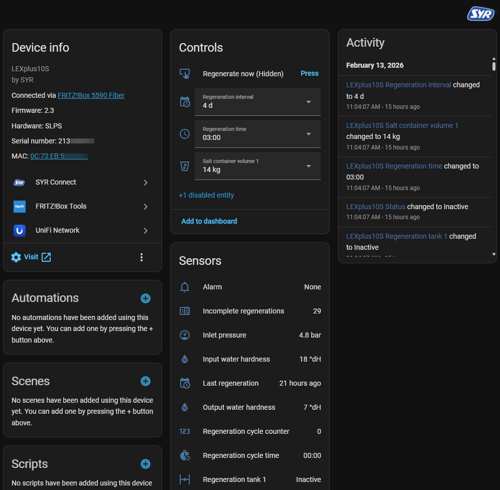

<!-- markdownlint-disable-next-line MD041 -->


# SYR Connect - Integrazione per Home Assistant

[](https://github.com/alexhass/syr_connect/releases)
[](https://my.home-assistant.io/redirect/config_flow_start/?domain=syr_connect)
[](https://github.com/alexhass/syr_connect/blob/main/quality_scale.yaml)

<!-- ha-marketplace:exclude-start -->

[](https://github.com/alexhass/syr_connect/actions/workflows/hassfest.yaml)
[](https://github.com/alexhass/syr_connect/actions/workflows/hacs.yaml)
[](https://github.com/alexhass/syr_connect/actions/workflows/ci.yml)
[](https://codecov.io/gh/alexhass/syr_connect)

<!-- ha-marketplace:exclude-end -->

Questa integrazione personalizzata consente di controllare i dispositivi SYR Connect tramite Home Assistant. Può essere utilizzata anche con dispositivi identici di altri marchi. Sono supportate anche installazioni miste di marchi diversi.

| Marchio | Link |
| ------ | ------ |
| comfort by sanibel | <https://comfort-by-sanibel.de/> |
| CONEL | <https://www.conel.de/> |
| DITECH | <https://www.ditech-haustechnik.de/> |
| Hansgrohe Pontos | <https://www.hansgrohe.de/> |
| mein concept | <https://www.mein-concept.de/> |
| mein Optima | <https://www.mein-optima.de/> |
| POLYGONVATRO | <https://www.polygongroup.com/de-DE/> |
| Reliance Valves | <https://www.rwc.com/brands/reliance-valves> |
| SYR | <https://www.syr.de/> |
| SYR Oceanic | <https://www.debestewaterbehandeling.be/> |
| TAKE | <https://take-bad.de/> |

## Schermate

Esempi di interfacce dei dispositivi:




<!-- ha-marketplace:exclude-start -->

## Installazione

[](https://my.home-assistant.io/redirect/marketplace_repository/?owner=alexhass&repository=syr_connect&category=integration)

### Marketplace (consigliato)

1. Andare su Impostazioni > Marketplace.
2. Cercare "SYR Connect".
3. Fare clic su "Installa".
4. Riavviare Home Assistant.

### Installazione manuale

1. Copiare la cartella `syr_connect` nella directory `custom_components`.
2. Riavviare Home Assistant.

<!-- ha-marketplace:exclude-end -->

## Configurazione

[](https://my.home-assistant.io/redirect/config_flow_start/?domain=syr_connect)

L'integrazione supporta due modalità di configurazione:

### Configurazione con l'API cloud (tutti i dispositivi)

1. Andare su Impostazioni > Dispositivi e servizi.
2. Fare clic su "+ Aggiungi integrazione".
3. Cercare "SYR Connect".
4. Selezionare "Cloud".
5. Inserire le credenziali dell'app per dispositivi mobili:
   - **Servizio**: L'app in cui sono configurati i dispositivi
   - **Nome utente**: Nome utente dell'account in questa app
   - **Password**: Password dell'account in questa app

### Configurazione con l'API locale (solo dispositivi più recenti)

Per i dispositivi più recenti con un'API JSON locale, ad esempio i dispositivi NeoSoft e Trio, SafeTech Lock, TRIO Lock, AC 3200 e RSA Connect e i loro dispositivi identici di altri marchi. La selezione del modello durante la configurazione elenca tutti i modelli supportati:

1. Andare su Impostazioni > Dispositivi e servizi.
2. Fare clic su "+ Aggiungi integrazione".
3. Cercare "SYR Connect".
4. Selezionare "Locale".
5. Inserire i dati del dispositivo:
   - **Modello del dispositivo**: Modello del dispositivo (ad es. NeoSoft 2500 Connect)
   - **Nome host o indirizzo IP**: Indirizzo IP o nome host del dispositivo (ad es. `192.168.178.199`)

**Nota**: L'indirizzo IP del dispositivo è indicato nell'elenco dei client DHCP del router o nel menu del display del dispositivo.

**Importante**: Per un funzionamento stabile, il dispositivo deve avere un **indirizzo IP statico** o un **lease DHCP riservato** (prenotazione DHCP). Se l'indirizzo IP del dispositivo cambia, l'integrazione perde la connessione. Il nuovo indirizzo si inserisce con "Riconfigura" nel menu a tre puntini (⋮) della voce. La voce resta legata al proprio dispositivo tramite il numero di serie: un altro dispositivo al nuovo indirizzo viene rifiutato e deve essere aggiunto come nuova voce. In alternativa si può usare un nome host, se la rete supporta la risoluzione DNS locale.

## Funzionalità

L'integrazione crea automaticamente le entità per tutti i dispositivi SYR Connect dell'account.

### Dispositivi supportati

Questa integrazione funziona con gli addolcitori d'acqua e i dispositivi di rilevamento perdite SYR e con altri dispositivi che compaiono nel cloud SYR Connect (tramite la rispettiva app per dispositivi mobili).

Testati e segnalati come funzionanti:

- CONEL CLEAR PRO FILL
- CONEL CLEAR PRO Floor Sensor
- CONEL CLEAR PRO LEAKAGE PROTECTION
- CONEL CLEAR PRO SOFT
- concept SafeFloor Floor Sensor
- DITECH Wireless Floor Sensor
- Optima T2 Floor Sensor
- POLYGONVATRO Wireless Floor Sensor
- Sanibel Leak Protection Module A25
- Sanibel Softwater UNO A25
- Sanibel Wireless Floor Sensor A25
- SYR All-in-One+
- SYR LEX 1500 Connect Single (LEX10/LEX20/LEX30/LEX40/LEX60/LEX80/LEX100)
- SYR LEX Plus 10 Connect
- SYR LEX Plus 10 S Connect
- SYR LEX Plus 10 SL Connect
- SYR NeoSoft 2500 Connect
- SYR SafeFloor Connect
- SYR Safe-T+ Connect
- SYR SafeTech Connect
- SYR SafeTech plus Connect
- SYR SafeTech V3 Connect
- SYR SafeTech V4 Connect
- SYR TRIO DFR/LS Connect 2425
- SYR TRIO Lock Connect
- SYR Oceanic i-LEX / Limex iQ Single (L10/L12/L15/L20/L25/L30/L40/L50/L60/L70/L80/L90/L100)

Anche altri dispositivi sono di interesse, ma potrebbero dover essere integrati o almeno testati (si prega di segnalarli):

- CONEL CLEAR PRO MULTICONTROL-KIT
- CONEL CLEAR PRO SOFT TWIN
- concept 200 Dual Water Softener
- concept 200 Replacement Filter
- concept 300 Automatic Backwash RSA
- concept 300 Trio Filter with Leak Protection
- concept Dual Water Softener
- concept Single Water Softener
- DITECH Automatic Backwash HWS/RF
- DITECH Backwash Filter Protect
- DITECH Connection Module Plus
- DITECH Dual Water Softener
- DITECH Hygiene Flush Box
- DITECH Single Water Softener
- Hansgrohe PontosBase
- Optima Dual Water Softener
- Optima Single Water Softener
- Optima T Replacement Filter
- Optima T2 Dual Water Softener
- POLYGONVATRO SafeTech Connect (venduto con l'assicurazione casa AXA come "Wasserwächter")
- RWC MultiSafe Floor Leak Sensor
- RWC MultiSafe Leak Detector Control Valve
- Sanibel Automatic Backwash System RSA A25
- Sanibel Softwater DUO A25
- SYR AC 3200 Connect
- SYR AC All-in-One 3228 Connect
- SYR CONTROLICmini
- SYR HVA
- SYR HygBox Connect
- SYR Hygiene Module (fredda / calda / fredda e calda)
- SYR Inliner-HWA 3300
- SYR IT 3000 Pendulum system
- SYR LEX 1500 Connect Alternating
- SYR LEX 1500 Connect Duplex
- SYR LEX 1500 Connect Triple
- SYR NeoDos Connect
- SYR NeoSoft 5000 Connect
- SYR NeoSoft Lock Connect I / II
- SYR RSA Connect
- SYR Safe-T Communication Module
- SYR Safe-T Hygiene Module
- SYR Safe-T Master / Slave
- SYR SafeTech Lock Connect
- SYR Trio LS Connect
- TAKE Dual Water Softener
- TAKE Single Water Softener

**Nota**: Se un dispositivo è visibile nell'account SYR Connect, l'integrazione lo rileva e crea automaticamente le entità. Per un "dispositivo non testato", la condivisione della diagnostica aiuta a trovare valori sconosciuti e a verificare che tutto funzioni come previsto. In questo modo si può anche ampliare l'elenco dei dispositivi testati.

### Dispositivi non supportati

- Dispositivi SYR Oceanic Limex SMART COMPACT/MINI/MAXI. Questi dispositivi usano un altro portale cloud (`i-lexconnect.com`) al posto del servizio cloud SYR Connect. Si tratta di dispositivi Husty SaoCal con un altro marchio.
- Dispositivi Husty SaoCal. Vedere [husty_integration_home_assistant](https://github.com/trafopowielacz/husty_integration_home_assistant).

### Funzionalità supportate

#### Sensori

L'integrazione offre un monitoraggio completo dei dispositivi:

#### Qualità dell'acqua e capacità

- Monitoraggio della durezza dell'acqua grezza e addolcita
- Conducibilità dell'acqua (µS/cm)
- Intervallo di durezza dell'acqua (dolce, media, dura), stimato dalla conducibilità (famiglia SafeTech)
- Fattore di conducibilità
- Temperatura dell'acqua (°C)
- Monitoraggio della capacità di addolcimento residua
- Capacità della resina per serbatoio (fino a 3 serbatoi, %)
- Monitoraggio del volume totale
- Visualizzazione dell'unità di durezza dell'acqua

#### Informazioni sulla rigenerazione

- Stato della rigenerazione e indicatore del serbatoio attivo (fino a 3 serbatoi)
- Modalità di rigenerazione (Standard / ECO / Power / Automatica)
- Numero di rigenerazioni eseguite
- Data e ora dell'ultima rigenerazione
- Impostazioni dell'intervallo di rigenerazione
- Orario di rigenerazione
- Contatori dei cicli e tempi

#### Gestione del sale

- Quantità di sale nei contenitori (1–3)
- Scorta di sale (settimane rimanenti)
- Capacità di riserva della resina per bottiglia

#### Monitoraggio del sistema

- Monitoraggio della pressione dell'acqua
- Portata (attuale e istantanea)
- Contatore di portata (consumo totale)
- Tensione della batteria e di rete
- Stato di allarmi, notifiche e avvisi (codice attuale e ultime 8 voci della cronologia)

#### Protezione perdite (LEXplus10SL / Trio DFR/LS)

- Limiti di volume e durata della protezione perdite (profili presenza e assenza)
- Indice del profilo protezione perdite attivo
- Profili di protezione perdite 1–8 (limite di volume, durata massima, soglia di portata, indicatori di avviso e cicalino)
- Timer di disattivazione temporanea
- Soglia di avviso perdita (%)

#### Test di microperdita (Trio DFR/LS, SafeTech, SafeTech+, TRIO Lock, SafeTech Lock)

- Intervallo e stato del test di microperdita
- Durata del test e numero di eventi

#### Fase di autoapprendimento (Trio DFR/LS, SafeTech+, TRIO Lock, SafeTech Lock)

- Tempo di autoapprendimento rimanente e trascorso
- Portata e volume accumulato durante l'autoapprendimento
- Impostazioni dell'autoapprendimento: margine di volume e tempo, margine di portata, portata minima

#### Sensore del pavimento (SafeFloor)

- Umidità e temperatura attuali
- Livello della batteria (%)
- Stato dell'allarme

#### Filtro e controlavaggio

- Tipo di filtro (SafeTech, SafeTech Lock, TRIO Lock, AC All-in-One 3228 Connect)
- Contenuto di ferro (famiglia LEX)
- Contatori dei controlavaggi automatici e manuali (controlavaggio automatico RSA)

#### Manutenzione

- Prossime date di manutenzione programmate (semestrale e annuale)
- Consumo d'acqua giornaliero previsto

#### Informazioni sul dispositivo

- Numero di serie
- Versione del firmware e modello
- Tipo di dispositivo e produttore
- Informazioni di rete (IP, MAC, gateway)
- Stato della connessione Wi-Fi e intensità del segnale
- Fuso orario (scostamento UTC)

#### Sensori binari

- **Cicalino in caso di allarme**: Indica se il cicalino suona in caso di allarme.
- **Protezione perdite**: Indica se la protezione perdite è attiva o disattivata.
- **Test valvola**: Indica se è in corso un test della valvola.
- **Controllo firmware**: Indica se è disponibile un nuovo firmware (controllato all'avvio e ogni 6 ore).
- **Ora legale**: Indica se il dispositivo passa automaticamente all'ora legale.
- **Sensore di temperatura**, **Sensore di pressione**, **Sensore di conducibilità**: Indicano se il sensore di misura è attivo o disattivato.
- **Monitoraggio sensore del pavimento**: Indica se il monitoraggio dei sensori del pavimento è attivato.

#### Pulsanti (azioni)

- **Rigenera ora**: Avviare una rigenerazione immediata.
- **Reimposta allarme**: Cancellare i messaggi di allarme attivi.
- **Reimposta notifica**: Cancellare i messaggi di notifica.
- **Reimposta avviso**: Cancellare i messaggi di avviso.
- **Avvia test di microperdita**: Avviare il test di microperdita. La valvola resta chiusa per circa 4 minuti e un prelievo d'acqua durante il test dà un risultato negativo (solo API locale).
- **Risciacquo manuale (acqua fredda)**, **Risciacquo manuale (acqua calda)**: Avviare un risciacquo manuale della tubazione dell'acqua (modulo igienico).

#### Interruttori

- **Cicalino in caso di allarme**: Attivare o disattivare il cicalino in caso di allarme.
- **Consenti cambio profilo sul dispositivo**: Consentire o bloccare il cambio del profilo protezione perdite con il tasto sul dispositivo.
- **Modalità di riempimento**: Attivare o disattivare il riempimento automatico (CLEAR PRO FILL All-in-One, AC All-in-One 3228 Connect, All-in-One+).
- **Riempimento iniziale**, **Riempimento manuale**: Avviare o arrestare il riempimento iniziale e il riempimento manuale (All-in-One+).
- **Controlavaggio automatico**: Attivare o disattivare il controlavaggio automatico (controlavaggio automatico RSA).
- **Promemoria controlavaggio**: Attivare o disattivare il promemoria del controlavaggio (controlavaggio automatico RSA).
- **Risciacquo per stagnazione**, **Risciacquo per temperatura**, **Risciacquo periodico**: Attivare o disattivare le tre funzioni di risciacquo (HygBox).

#### Selettori (configurazione)

- **Ora di rigenerazione**: Impostare l'ora giornaliera della rigenerazione (intervalli di 15 minuti).
- **Profilo protezione perdite attivo**: Selezionare il profilo protezione perdite attivo (per dispositivi con più profili).
- **Quantità di sale nel contenitore 1–3**: Impostare la quantità di sale per contenitore (a seconda del modello, fino a 3 contenitori).
- **Intervallo di rigenerazione**: Impostare la frequenza della rigenerazione (a seconda del modello: fino a 3, 4 o 99 giorni).
- **Orientamento del display**: Impostare l'orientamento del display (0 / 90 / 180 / 270 gradi, per dispositivi con display).
- **Modalità di rigenerazione**: Selezionare Standard / ECO / Power / Automatica (per i dispositivi che la supportano).
- **Durezza acqua grezza**, **Durezza acqua addolcita**: Impostare la durezza dell'acqua grezza e dell'acqua addolcita (famiglia LEX, CLEAR PRO FILL All-in-One, AC All-in-One 3228 Connect, All-in-One+). L'unità segue l'unità di durezza configurata sul dispositivo (°dH, °fH, °e, mg/l CaCO₃, ppm, mmol/l o mval/l).
- **Trattamento dell'acqua e riempimento** (CLEAR PRO FILL All-in-One, AC All-in-One 3228 Connect, All-in-One+): Dimensione e tipo della cartuccia, durezza dell'acqua addolcita o conducibilità massima in uscita (a seconda della cartuccia), periodo di riempimento, numero di cicli di riempimento, durata e quantità massime di riempimento, pressione di destinazione.
- **Sensore del pavimento** (SafeFloor): Durata dell'allarme, soglie minime e massime di umidità e temperatura ("Off" disattiva una soglia), intervallo di misura e intervallo di sincronizzazione delle impostazioni.
- **Risciacquo igienico** (HygBox): Tipo d'acqua, tempo di stagnazione e volume di risciacquo, temperatura di avvio e di arresto, durata massima del risciacquo e risciacqui al giorno, intervallo e volume del risciacquo periodico, intervallo di sincronizzazione delle impostazioni.
- **Risciacquo igienico** (modulo igienico, Safe-T Hygiene Module): Tempo di stagnazione, intervallo di risciacquo, limite di temperatura, durata massima e volume massimo di risciacquo della tubazione dell'acqua fredda e di quella dell'acqua calda.
- **Dosaggio** (NeoDos Connect): Dimensione della tanica, liquido di dosaggio e modalità di funzionamento.

#### Controllo della valvola

- **Chiusura valvola**: Controllare la valvola principale di intercettazione dell'acqua.
  - Aprire e chiudere la valvola.
  - Monitorare la posizione e lo stato attuali della valvola.
  - Integrazione con automazioni di rilevamento perdite per la chiusura automatica.

#### Aggiornamento firmware

- **Aggiornamento firmware**: Indica se è disponibile un nuovo firmware e lo installa. Il dispositivo deve essere connesso a Internet. Il dispositivo non comunica il numero della nuova versione.

### Modalità API

L'integrazione supporta due modalità API:

#### API cloud (basata su XML)

- **Supportata da**: Tutti i dispositivi SYR Connect
- **Connessione**: Tramite il servizio cloud SYR Connect
- **Autenticazione**: Nome utente e password dell'account SYR Connect
- **Vantaggi**: Funziona con tutti i modelli di dispositivo, accesso remoto da qualsiasi luogo
- **Requisiti**: Connessione a Internet, account SYR Connect

#### API locale (basata su JSON)

- **Supportata da**: Modelli più recenti con un'API locale integrata, ad esempio NeoSoft, Trio DFR/LS, TRIO Lock, SafeTech Lock, AC 3200, RSA, Pontos Base, All-in-One+, HygBox e varianti più recenti di SafeTech, anche di altri marchi. La selezione del modello durante la configurazione elenca tutti i modelli supportati.
- **Connessione**: Diretta con il dispositivo tramite la rete locale (porta 5333).
- **Autenticazione**: Non sono necessarie credenziali.
- **Vantaggi**: Nessuna dipendenza da Internet, tempi di risposta più rapidi, nessun limite di richieste del cloud.
- **Requisiti**: Il dispositivo deve trovarsi nella stessa rete di Home Assistant e necessita di un indirizzo IP statico o di un nome host.

La modalità API si sceglie durante la configurazione (Cloud o Locale).

## Come vengono aggiornati i dati

L'integrazione interroga l'API del dispositivo a intervalli regolari (predefinito: 60 secondi). Il processo di aggiornamento dipende dalla modalità API:

### Processo di aggiornamento con l'API cloud

1. **Accesso**: Si autentica presso l'API cloud SYR Connect con le credenziali.
2. **Rilevamento dei dispositivi**: Recupera tutti i progetti e i dispositivi associati all'account, all'avvio e poi ogni 30 minuti. Un dispositivo eliminato dall'account viene rimosso da Home Assistant insieme alle sue entità.
3. **Aggiornamenti di stato**: Per ogni dispositivo recupera lo stato attuale con tutti i valori dei sensori.
4. **Aggiornamenti delle entità**: Aggiorna tutte le entità di Home Assistant con i valori più recenti.

### Processo di aggiornamento con l'API locale

1. **Aggiornamenti di stato**: Recupera lo stato del dispositivo direttamente dall'endpoint locale.
2. **Aggiornamenti delle entità**: Aggiorna tutte le entità di Home Assistant con i valori più recenti.

L'API locale è più veloce e non dipende dalla connessione a Internet, il che la rende più affidabile per il monitoraggio in tempo reale e le automazioni.

Se un aggiornamento non riesce temporaneamente (ad es. timeout, manutenzione del cloud o risposta incompleta), le entità mantengono gli ultimi valori e l'errore viene scritto nel registro. Le entità diventano non disponibili solo quando il cloud segnala il dispositivo come offline. Restano non disponibili finché il dispositivo non invia di nuovo uno stato completo.

Finché non è possibile recuperare alcun dato, l'integrazione interroga meno spesso: l'intervallo raddoppia dopo ogni aggiornamento non riuscito, fino a 15 minuti. Il primo aggiornamento riuscito ripristina l'intervallo configurato.

Se per più di 1 ora non è possibile recuperare dati, il guasto non è più considerato temporaneo: le entità interessate diventano non disponibili e viene mostrato un messaggio in **Impostazioni** → **Riparazioni**. Entrambi scompaiono non appena i dati vengono di nuovo recuperati.

### Cronologia delle misurazioni del SafeFloor

Un SafeFloor misura regolarmente temperatura e umidità, ma invia le misurazioni al cloud solo ogni pochi giorni, per cui i suoi sensori mostrano una linea piatta seguita da un salto. L'integrazione recupera dal cloud le singole misurazioni ogni 12 ore e le salva come statistiche con il nome dei sensori (ad es. "Lavanderia Temperatura"). Per vedere la curva reale si aggiunge una scheda a una plancia:

1. Aprire la plancia e selezionare **Modifica plancia** in alto a destra.
2. Selezionare **Aggiungi scheda**, digitare `Statistics` in **Cerca schede** e scegliere **Grafico delle statistiche**.
3. Selezionare **Mostra editor di codice**, sostituire il testo con uno dei frammenti seguenti e selezionare **Salva**.
4. Selezionare **Fatto**.

`123456789` va sostituito con il numero di serie del SafeFloor. È necessaria una scheda per ogni misurazione.

Temperatura:

```yaml
type: statistics-graph
title: Temperatura
chart_type: line
period: hour
days_to_show: 14
stat_types:
  - mean
entities:
  - syr_connect:123456789_getcel_history
```

Umidità:

```yaml
type: statistics-graph
title: Umidità
chart_type: line
period: hour
days_to_show: 14
stat_types:
  - mean
entities:
  - syr_connect:123456789_gethmd_history
```

Il cloud conserva solo le misurazioni degli ultimi 6 giorni. L'intervallo di sincronizzazione del sensore deve restare di 6 giorni o meno, altrimenti le misurazioni vanno perse. Le statistiche vengono eliminate insieme al dispositivo.

### Limitazioni note

- **Dipendenza dal cloud**: L'API cloud richiede una connessione a Internet attiva e un servizio cloud funzionante.
- **Intervallo di aggiornamento**: L'API cloud consente un intervallo di aggiornamento di almeno 60 secondi, l'API locale di almeno 10 secondi.
- **Accesso in scrittura limitato**: Le modifiche della configurazione (ora di rigenerazione, quantità di sale, intervalli) e le azioni di controllo (rigenerazione, controllo della valvola) sono supportate, ma alcune impostazioni avanzate potrebbero essere disponibili solo nell'app SYR Connect.
- **Supporto dell'API locale**: Non tutti i modelli offrono un'API JSON locale. LEX 1500, LEXplus, i-LEX, Safe-T, SafeFloor, HVA, i moduli igienici e le varianti più vecchie di SafeTech richiedono l'accesso tramite l'API cloud.

## Casi d'uso ed esempi

### Esempi di automazioni

Gli esempi usano la sintassi YAML di `configuration.yaml`. In tutti gli esempi, `<serial_number>` va sostituito con il numero di serie del dispositivo e `<device_name>` con il nome del dispositivo dell'app per dispositivi mobili in Home Assistant.

#### Avviso sale scarso

Notifica quando la scorta di sale si sta esaurendo:

```yaml
automation:
  - alias: "SYR: Avviso sale scarso"
    triggers:
      - trigger: numeric_state
        entity_id: sensor.syr_connect_<serial_number>_getss1
        below: 2  # Meno di 2 settimane di sale rimanenti
    actions:
      - action: notify.mobile_app_<device_name>
        data:
          title: "Addolcitore d'acqua"
          message: "Scorta di sale scarsa - meno di 2 settimane rimanenti"
```

#### Rapporto giornaliero sulla rigenerazione

Riepilogo giornaliero delle rigenerazioni, della capacità residua e della scorta di sale:

```yaml
automation:
  - alias: "SYR: Rapporto giornaliero sulla rigenerazione"
    triggers:
      - trigger: time
        at: "20:00:00"
    actions:
      - action: notify.mobile_app_<device_name>
        data:
          title: "Rapporto giornaliero dell'addolcitore d'acqua"
          message: >
            Rigenerazioni (totale): {{ states('sensor.syr_connect_<serial_number>_getnor') }}
            Capacità residua: {{ states('sensor.syr_connect_<serial_number>_getres') }} L
            Scorta di sale: {{ states('sensor.syr_connect_<serial_number>_getss1') }} settimane
```

#### Notifica di allarme

Notifica immediata quando il dispositivo segnala un allarme:

```yaml
automation:
  - alias: "SYR: Notifica di allarme"
    triggers:
      - trigger: template
        value_template: >
          {{ states('sensor.syr_connect_<serial_number>_getala')
             not in ['no_alarm', 'unknown', 'unavailable'] }}
    actions:
      - action: notify.mobile_app_<device_name>
        data:
          title: "⚠️ Allarme SYR"
          message: "Allarme attuale: {{ states('sensor.syr_connect_<serial_number>_getala') }}"
          data:
            priority: high
```

#### Monitoraggio della portata d'acqua

Avviso in caso di portata d'acqua insolitamente elevata per diversi minuti (possibile perdita):

```yaml
automation:
  - alias: "SYR: Avviso portata elevata"
    triggers:
      - trigger: numeric_state
        entity_id: sensor.syr_connect_<serial_number>_getflo
        above: 1200  # Portata superiore a 1200 l/h (20 l/min)
        for:
          minutes: 5
    actions:
      - action: notify.mobile_app_<device_name>
        data:
          title: "Rilevata portata d'acqua elevata"
          message: "Portata d'acqua insolita - possibile perdita"
```

#### Sensore di perdita: chiudere la valvola dell'acqua

Chiude la valvola di intercettazione dell'acqua SYR con l'azione standard `valve.close` quando un sensore di perdita rileva acqua. Gli ID delle entità vanno sostituiti con quelli usati nell'impianto. Questa automazione può diventare un'azione di sicurezza critica e deve quindi essere testata con molta attenzione.

```yaml
automation:
  - alias: "SYR: Chiudere la valvola in caso di perdita"
    triggers:
      - trigger: state
        entity_id: binary_sensor.house_leak_sensor
        to: "on"
    actions:
      - action: valve.close
        target:
          entity_id: valve.syr_connect_<serial_number>_getab
      - action: notify.mobile_app_<device_name>
        data:
          title: "SYR: Perdita rilevata - valvola chiusa"
          message: "Rilevata una perdita d'acqua - la valvola di intercettazione dell'acqua SYR è stata chiusa automaticamente."
```

#### Rigenerazione nel fine settimana

Avvia una rigenerazione il sabato e la domenica alle 03:00:

```yaml
automation:
  - alias: "SYR: Rigenerazione nel fine settimana"
    triggers:
      - trigger: time
        at: "03:00:00"
    conditions:
      - condition: time
        weekday:
          - sat
          - sun
    actions:
      - action: button.press
        target:
          entity_id: button.syr_connect_<serial_number>_setsir
```

## Opzioni di configurazione

### Intervallo di aggiornamento

Per impostazione predefinita i dati vengono aggiornati ogni 60 secondi. L'intervallo si imposta nelle opzioni dell'integrazione: almeno 60 secondi per il cloud, almeno 10 secondi per i dispositivi locali e al massimo 600 secondi in entrambi i casi.

1. Aprire Impostazioni > Dispositivi e servizi.
2. Aprire l'integrazione SYR Connect.
3. Selezionare "Configura".
4. Regolare l'intervallo di aggiornamento (in secondi).

## Rimozione

Per rimuovere l'integrazione da Home Assistant:

1. Andare su Impostazioni > Dispositivi e servizi.
2. Cercare l'integrazione SYR Connect.
3. Fare clic sul menu a tre puntini (⋮).
4. Selezionare "Elimina".
5. Confermare l'eliminazione.

Tutti i dispositivi e le entità associati vengono rimossi automaticamente.

## Risoluzione dei problemi

### Scaricare la diagnostica

In caso di problemi è utile la diagnostica della voce dell'integrazione. Contiene i dati di tutti i dispositivi della voce:

1. Aprire Impostazioni > Dispositivi e servizi.
2. Aprire l'integrazione SYR Connect.
3. Aprire il menu a tre puntini (⋮) della voce (account o dispositivo locale).
4. Selezionare "Scarica diagnostica".

Password, nomi utente, dati di sessione, numero di codice del dispositivo, indirizzi IP, gateway e nome della rete Wi-Fi vengono rimossi dal file e il numero di serie viene mascherato.

### Registri di debug

L'attivazione e la disattivazione dei registri di debug sono descritte in [docs/howto-debugging.md](docs/howto-debugging.md) (in inglese).

### La connessione non riesce

- **Controllare le credenziali**: Verificare nome utente e password dell'app SYR Connect.
- **Provare l'app**: L'accesso all'app SYR Connect per dispositivi mobili deve funzionare con lo stesso account.
- **Controllare i registri**: Andare su Impostazioni > Sistema > Registri e cercare gli errori di "syr_connect".
- **Problemi di rete**: Home Assistant deve avere accesso a Internet.

### Errori di autenticazione

In caso di errori "Authentication failed":

1. Verificare le credenziali.
2. L'integrazione richiede una nuova autenticazione.
3. Andare su Impostazioni > Dispositivi e servizi.
4. Fare clic su "Autentica" nell'integrazione SYR Connect.
5. Inserire di nuovo le credenziali.

La nuova autenticazione e "Riconfigura" modificano solo la password dell'account. Un altro nome utente è un altro account: lì viene rifiutato e deve essere aggiunto come nuova voce.

### Nessun dispositivo trovato

- **Configurazione dell'app**: I dispositivi devono essere configurati correttamente nell'app SYR Connect.
- **Accesso all'account**: L'account deve essere quello in cui sono configurati i dispositivi.
- **Stato dei dispositivi**: Verificare se i dispositivi sono online nell'app SYR Connect.
- **Registri**: Controllare i registri di Home Assistant per messaggi di errore specifici.

### Le entità risultano non disponibili

- **Dispositivo offline**: Il cloud segnala il dispositivo come offline. Devono essere controllate l'alimentazione elettrica e la connessione di rete del dispositivo.
- **App SYR Connect**: Il dispositivo deve risultare online nell'app SYR Connect.
- **Di nuovo online**: Le entità tornano disponibili non appena il dispositivo invia uno stato completo.

- **Nessuna connessione da più di 1 ora**: Per più di 1 ora non è stato possibile recuperare dati dal cloud o dal dispositivo. Viene mostrato un messaggio in **Impostazioni** → **Riparazioni**. Devono essere controllati la connessione a Internet e lo stato del cloud SYR Connect.
- **Problema di rete**: Se il nome host non è stato risolto o non è stato possibile aprire alcuna connessione, il messaggio indica la rete come causa. Devono essere controllati la connessione di rete e le impostazioni DNS di Home Assistant e, per un dispositivo locale, anche il suo indirizzo IP.

I problemi temporanei con la connessione o con il servizio cloud non rendono le entità non disponibili. Le entità mantengono gli ultimi valori e l'errore viene scritto nel registro.

### Utilizzo elevato di CPU o memoria

- **Aumentare l'intervallo di aggiornamento**: Impostare un valore più alto (ad es. 120–300 secondi) nelle opzioni dell'integrazione.
- Questo riduce le chiamate API e il carico del sistema.

<!-- ha-marketplace:exclude-start -->

## Dipendenze

L'integrazione richiede i seguenti pacchetti Python:

- `pycryptodomex>=3.19.0,<4.0`: Per la cifratura e la decifratura AES
- `defusedxml>=0.7.1,<1.0`: Per l'analisi sicura dell'XML (previene gli attacchi XXE)

**Nota**: L'integrazione usa `defusedxml` per l'analisi sicura dell'XML e `pycryptodomex` (non `pycryptodome`) per evitare conflitti con le librerie crittografiche integrate in Home Assistant.

Home Assistant installa i pacchetti **automaticamente** quando:

1. L'integrazione viene aggiunta tramite l'interfaccia utente.
2. Home Assistant viene riavviato dopo l'installazione.

I requisiti di sistema dettagliati e la risoluzione dei problemi si trovano in [REQUIREMENTS.md](REQUIREMENTS.md) (in inglese).

<!-- ha-marketplace:exclude-end -->

## Esclusione di responsabilità

### IMPORTANTE: Leggere prima di usare l'integrazione

Questa integrazione controlla sistemi di trattamento dell'acqua e di intercettazione dell'acqua. Una configurazione errata o automazioni difettose possono causare danni da acqua, guasti del sistema o danni materiali.

- **Uso a proprio rischio**: Questo software viene fornito "così com'è", senza garanzie di alcun tipo.
- **Test accurati**: Le automazioni devono sempre essere testate in condizioni sicure prima della messa in funzione.
- **Sistemi critici**: Le automazioni di controllo della valvola possono interrompere l'intera fornitura d'acqua e devono essere testate con attenzione.
- **Nessuna responsabilità**: Gli autori e i collaboratori non sono responsabili di danni, danni da acqua, danni materiali o altri problemi derivanti dall'uso di questa integrazione.
- **Dipendenza dal cloud**: Questa integrazione si basa sul servizio cloud SYR Connect, la cui disponibilità non è garantita.
- **Piano di riserva**: Deve esistere un accesso alternativo alla valvola di intercettazione dell'acqua in caso di guasto del sistema.

L'installazione e l'uso di questa integrazione implicano il riconoscimento di questi rischi e l'impegno a usarla in modo responsabile.

## Licenza

Apache License 2.0, vedere [LICENSE](LICENSE)

## Ringraziamenti

- Ispirato all'adattatore [ioBroker.syrconnectapp](https://github.com/TA2k/ioBroker.syrconnectapp) di TA2k.
- Un grande ringraziamento al SYR IoT-Development-Team per aver condiviso i loghi.
