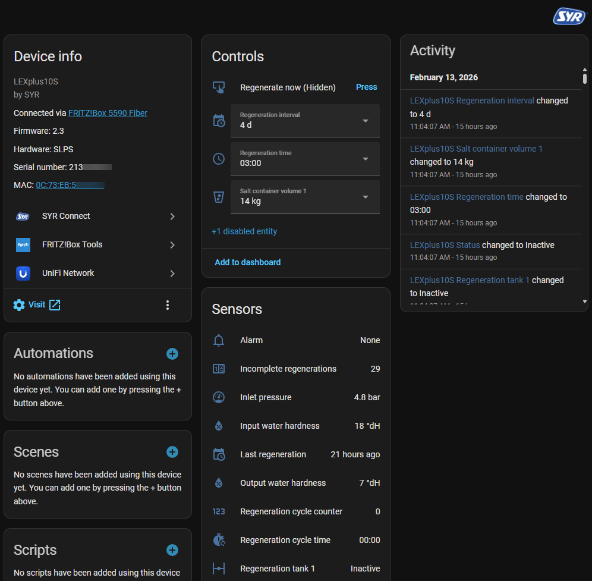
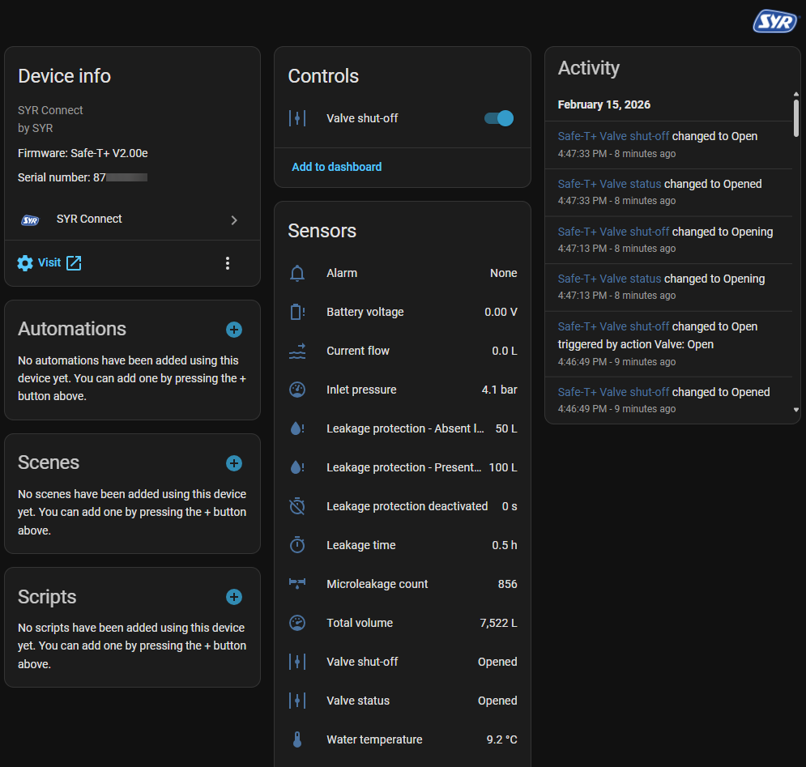

<!-- markdownlint-disable-next-line MD041 -->


# SYR Connect - Home Assistant Integration

[](https://github.com/alexhass/syr_connect/releases)
[](https://my.home-assistant.io/redirect/config_flow_start/?domain=syr_connect)
[](https://github.com/alexhass/syr_connect/blob/main/quality_scale.yaml)

[](https://github.com/alexhass/syr_connect/actions/workflows/hassfest.yaml)
[](https://github.com/alexhass/syr_connect/actions/workflows/hacs.yaml)
[](https://github.com/alexhass/syr_connect/actions/workflows/ci.yml)
[](https://codecov.io/gh/alexhass/syr_connect)

This custom integration enables control of SYR Connect devices through Home Assistant. This integration can also be used with identical devices from other brands. Mixed installations of different brands are supported as well.

| Brand | Link |
| ------ | ------ |
| comfort by sanibel | <https://comfort-by-sanibel.de/> |
| CONEL | <https://www.conel.de/> |
| DITECH | <https://www.ditech-haustechnik.de/> |
| Hansgrohe Pontos | <https://www.hansgrohe.de/> |
| mein concept | <https://www.mein-concept.de/> |
| mein Optima | <https://www.mein-optima.de/> |
| POLYGONVATRO | <https://www.polygongroup.com/de-DE/> |
| Reliance Valves | <https://www.rwc.com/brands/reliance-valves> |
| SYR | <https://www.syr.de/> |
| SYR Oceanic | <https://www.debestewaterbehandeling.be/> |
| TAKE | <https://take-bad.de/> |

## Screenshots

Examples of device interfaces:





## Installation

[](https://my.home-assistant.io/redirect/marketplace_repository/?owner=alexhass&repository=syr_connect&category=integration)

### Marketplace (recommended)

1. Go to Settings > Marketplace.
2. Search for "SYR Connect".
3. Click "Install".
4. Restart Home Assistant.

### Manual installation

1. Copy the `syr_connect` folder to the `custom_components` directory.
2. Restart Home Assistant.

## Configuration

[](https://my.home-assistant.io/redirect/config_flow_start/?domain=syr_connect)

The integration supports two configuration modes:

### Cloud API setup (all devices)

1. Go to Settings > Devices & Services.
2. Click "+ Add Integration".
3. Search for "SYR Connect".
4. Select "Cloud".
5. Enter the credentials of the mobile app:
   - **Service**: The app in which the devices are set up
   - **Username**: Username of the account in this app
   - **Password**: Password of the account in this app

### Local API setup (newer devices only)

For newer devices with a local JSON API, for example the NeoSoft and Trio devices, SafeTech Lock, TRIO Lock, AC 3200 and RSA Connect and their identical devices of other brands. The model selection in the setup lists all supported models:

1. Go to Settings > Devices & Services.
2. Click "+ Add Integration".
3. Search for "SYR Connect".
4. Select "Local".
5. Enter the device information:
   - **Device model**: Model of the device (e.g., NeoSoft 2500 Connect)
   - **Host**: IP address or hostname of the device (e.g., `192.168.178.199`)

**Note**: The IP address of the device is shown in the DHCP client list of the router or in the display menu of the device.

**Important**: For stable operation, the device must have a **static IP address** or a **reserved DHCP lease** (DHCP reservation). If the IP address of the device changes, the integration loses the connection. The new address is entered with "Reconfigure" in the three dots menu (⋮) of the entry. Alternatively, a hostname can be used if the network supports local DNS resolution.

## Features

The integration automatically creates entities for all SYR Connect devices of the account.

### Supported devices

This integration works with SYR water softeners and leakage detection devices and other that appear in the SYR Connect cloud (via the respective mobile app).

Tested and reported as working:

- CONEL CLEAR PRO FILL
- CONEL CLEAR PRO Floor Sensor
- CONEL CLEAR PRO LEAKAGE PROTECTION
- CONEL CLEAR PRO SOFT
- concept SafeFloor Floor Sensor
- DITECH Wireless Floor Sensor
- Optima T2 Floor Sensor
- POLYGONVATRO Wireless Floor Sensor
- Sanibel Leak Protection Module A25
- Sanibel Softwater UNO A25
- Sanibel Wireless Floor Sensor A25
- SYR LEX 1500 Connect Single (LEX10/LEX20/LEX30/LEX40/LEX60/LEX80/LEX100)
- SYR LEX Plus 10 Connect
- SYR LEX Plus 10 S Connect
- SYR LEX Plus 10 SL Connect
- SYR NeoSoft 2500 Connect
- SYR SafeFloor Connect
- SYR Safe-T+ Connect
- SYR SafeTech Connect
- SYR SafeTech plus Connect
- SYR SafeTech V3 Connect
- SYR SafeTech V4 Connect
- SYR TRIO DFR/LS Connect 2425
- SYR TRIO Lock Connect
- SYR Oceanic i-LEX / Limex iQ Single (L10/L12/L15/L20/L25/L30/L40/L50/L60/L70/L80/L90/L100)

Other devices are also of interest, but may need to be integrated or at least tested (please report):

- CONEL CLEAR PRO MULTICONTROL-KIT
- CONEL CLEAR PRO SOFT TWIN
- concept 200 Dual Water Softener
- concept 200 Replacement Filter
- concept 300 Automatic Backwash RSA
- concept 300 Trio Filter with Leak Protection
- concept Dual Water Softener
- concept Single Water Softener
- DITECH Automatic Backwash HWS/RF
- DITECH Backwash Filter Protect
- DITECH Connection Module Plus
- DITECH Dual Water Softener
- DITECH Hygiene Flush Box
- DITECH Single Water Softener
- Hansgrohe PontosBase
- Optima Dual Water Softener
- Optima Single Water Softener
- Optima T Replacement Filter
- Optima T2 Dual Water Softener
- POLYGONVATRO SafeTech Connect (sold with AXA building insurance as "Wasserwächter")
- RWC MultiSafe Floor Leak Sensor
- RWC MultiSafe Leak Detector Control Valve
- Sanibel Automatic Backwash System RSA A25
- Sanibel Softwater DUO A25
- SYR AC 3200 Connect
- SYR AC All-in-One 3228 Connect
- SYR All-in-One+
- SYR CONTROLICmini
- SYR HVA
- SYR HygBox Connect
- SYR Hygiene Module (cold / hot / cold and hot)
- SYR Inliner-HWA 3300
- SYR IT 3000 Pendulum system
- SYR LEX 1500 Connect Alternating
- SYR LEX 1500 Connect Duplex
- SYR LEX 1500 Connect Triple
- SYR NeoDos Connect
- SYR NeoSoft 5000 Connect
- SYR NeoSoft Lock Connect I / II
- SYR RSA Connect
- SYR Safe-T Communication Module
- SYR Safe-T Master / Slave
- SYR SafeTech Lock Connect
- SYR Trio LS Connect
- TAKE Dual Water Softener
- TAKE Single Water Softener
- Other SYR models with Connect capability or a retrofitted gateway that show up in the SYR Connect portal

**Note**: If a device is visible in the SYR Connect account, the integration discovers it and creates the entities automatically. For an "untested device", shared diagnostics help to find unknown values and to check whether everything works as intended. This also allows the list of tested devices to be expanded.

### Unsupported devices

- SYR Oceanic Limex SMART COMPACT/MINI/MAXI devices. These devices use a different cloud portal (`i-lexconnect.com`) instead of the SYR Connect cloud service. These are rebranded Husty SaoCal devices.
- Husty SaoCal devices. See [husty_integration_home_assistant](https://github.com/trafopowielacz/husty_integration_home_assistant).

### Supported functionality

#### Sensors

The integration provides comprehensive monitoring of the devices:

#### Water quality & capacity

- Raw/Soft water hardness monitoring
- Water conductivity (µS/cm)
- Water hardness range (soft, medium, hard), estimated from the conductivity (SafeTech family)
- Conductivity factor
- Water temperature (°C)
- Remaining softening capacity tracking
- Resin capacity per tank (up to 3 tanks, %)
- Total volume monitoring
- Water hardness unit display

#### Regeneration information

- Regeneration status and active-tank indicator (up to 3 tanks)
- Regeneration mode (Standard / ECO / Power / Automatic)
- Number of regenerations performed
- Last regeneration timestamp
- Regeneration interval settings
- Regeneration time schedule
- Cycle counters and timing

#### Salt management

- Salt volume in containers (1–3)
- Salt stock levels (weeks remaining)
- Resin reserve capacity per bottle

#### System monitoring

- Water pressure monitoring
- Flow rate (current and instantaneous)
- Flow counter (total consumption)
- Battery and mains voltage
- Alarm, notification, and warning status (current code and last 8 history entries)

#### Leak protection (LEXplus10SL / Trio DFR/LS)

- Leak protection volume and duration limits (present and absent profiles)
- Active leak protection profile index
- Leak protection profiles 1–8 (volume limit, max duration, flow threshold, warning and buzzer flags)
- Temporary deactivation timer
- Leakage warning threshold (%)

#### Microleakage test (Trio DFR/LS, SafeTech, SafeTech+, TRIO Lock, SafeTech Lock)

- Microleakage test interval and status
- Test duration and event count

#### Self-learning phase (Trio DFR/LS, SafeTech+, TRIO Lock, SafeTech Lock)

- Remaining and elapsed self-learning time
- Flow rate and accumulated volume during self-learning
- Self-learning settings: offset for volume and time, offset for flow, minimum flow

#### Floor sensor (SafeFloor)

- Current humidity and temperature
- Battery level (%)
- Alarm status

#### Filter (NeoSoft)

- Filter backwash countdown
- Filter type
- Iron content measurement

#### Maintenance

- Next scheduled maintenance dates (semi-annual and annual)
- Expected daily water consumption

#### Device information

- Serial number
- Firmware version and model
- Device type and manufacturer
- Network information (IP, MAC, Gateway)
- Wi-Fi connectivity status and signal strength
- Time zone (UTC offset)

#### Binary sensors

- **Buzzer on alarm**: Shows whether the buzzer sounds on alarm.
- **Leak protection**: Shows whether the leak protection is active or deactivated.
- **Valve test**: Shows whether a valve test is running.
- **Firmware check**: Shows whether new firmware is available (checked at startup and every 6 hours).
- **Daylight saving time**: Shows whether the device switches to daylight saving time automatically.
- **Temperature sensor**, **Pressure sensor**, **Conductivity sensor**: Show whether the measuring sensor is active or deactivated.
- **Floor sensor monitoring**: Shows whether the monitoring of the floor sensors is enabled.

#### Buttons (Actions)

- **Regenerate now**: Start an immediate regeneration.
- **Reset alarm**: Clear active alarm messages.
- **Reset notification**: Clear notification messages.
- **Reset warning**: Clear warning messages.
- **Start microleakage test**: Start the microleakage test. The valve stays closed for about 4 minutes, and drawing water during the test gives a negative result (local API only).

#### Switches

- **Buzzer on alarm**: Enable or disable the buzzer on alarm.
- **Allow profile change on the device**: Allow or block changing the leak protection profile with the button on the device.
- **Filling mode**: Enable or disable the automatic filling (CLEAR PRO FILL All-in-One, AC All-in-One 3228 Connect).
- **Automatic backwash**: Enable or disable the automatic backwash (automatic backwash RSA).
- **Backwash reminder**: Enable or disable the backwash reminder (automatic backwash RSA).
- **Stagnation flushing**, **Temperature flushing**, **Periodic flushing**: Enable or disable the three flushing functions (HygBox).

#### Selects (configuration)

- **Regeneration time**: Set the daily regeneration time (15-minute intervals).
- **Active leak protection profile**: Select the active leak protection profile (for devices with multiple profiles).
- **Salt volume in container 1–3**: Set the salt volume per container (varies by model, up to 3 containers).
- **Regeneration interval**: Set how often regeneration occurs (model dependent: 1–4 days).
- **Display orientation**: Set the display orientation (0 / 90 / 180 / 270 degrees, for devices with a display).
- **Regeneration mode**: Select Standard / ECO / Power / Automatic (for devices that support it).
- **Raw water hardness**, **Soft water hardness**: Set the raw and softened water hardness (LEX family only). The unit follows the hardness unit configured on the device (°dH, °fH, °e, mg/l CaCO₃, ppm, mmol/l or mval/l).
- **Water treatment and filling** (CLEAR PRO FILL All-in-One, AC All-in-One 3228 Connect): Cartridge size and type, soft water hardness or maximum output conductivity (depending on the cartridge), filling period, number of filling cycles, maximum filling duration and amount, target pressure.
- **Floor sensor** (SafeFloor): Alarm duration, minimum and maximum humidity and temperature thresholds ("Off" disables a threshold), measurement interval and settings synchronization interval.
- **Hygiene flushing** (HygBox): Water type, stagnation time and flushing volume, start and stop temperature, maximum flushing duration and flushings per day, interval and flushing volume of the periodic flushing, settings synchronization interval.
- **Dosing** (NeoDos Connect): Canister size, dosing liquid and operating mode.

#### Valve control

- **Valve shut-off**: Control the main water shut-off valve.
  - Open and close valve operations.
  - Monitor current valve position and status.
  - Integrate with leak detection automations for automatic shutoff.

#### Firmware update

- **Firmware update**: Shows whether new firmware is available and installs it. The device must be connected to the internet. The device does not report the number of the new version.

### API modes

The integration supports two API modes:

#### Cloud API (XML-based)

- **Supported by**: All SYR Connect devices
- **Connection**: Via SYR Connect cloud service
- **Authentication**: Username and password from SYR Connect account
- **Advantages**: Works with all device models, remote access from anywhere
- **Requirements**: Internet connection, SYR Connect account

#### Local API (JSON-based)

- **Supported by**: Newer models with a built-in local API, for example NeoSoft, Trio DFR/LS, TRIO Lock, SafeTech Lock, AC 3200, RSA, Pontos Base, All-in-One+, HygBox and newer SafeTech variants, also from other brands. The model selection in the setup lists all supported models.
- **Connection**: Direct to device via local network (port 5333).
- **Authentication**: No credentials required.
- **Advantages**: No internet dependency, faster response times, no cloud rate limits.
- **Requirements**: Device must be on same network as Home Assistant, device needs static IP address or hostname.

The integration automatically detects which API mode to use based on the configuration provided during setup.

## How data is updated

The integration polls the device API at regular intervals (default: 60 seconds). The update process depends on the API mode:

### Cloud API update process

1. **Login**: Authenticates with the SYR Connect cloud API using the credentials.
2. **Device discovery**: Retrieves all projects and devices associated with the account.
3. **Status updates**: For each device, fetches current status including all sensor values.
4. **Entity updates**: Updates all Home Assistant entities with the latest values.

### Local API update process

1. **Status updates**: Directly fetches device status from the local endpoint.
2. **Entity updates**: Updates all Home Assistant entities with the latest values.

The local API is faster and doesn't depend on internet connectivity, making it more reliable for real-time monitoring and automations.

If an update fails temporarily (e.g., timeout, cloud maintenance or an incomplete answer), the entities keep their last values and the error is written to the log. Entities only become unavailable when the cloud reports the device as offline. They stay unavailable until the device sends a complete status again.

### SafeFloor measurement history

A SafeFloor measures temperature and humidity regularly but sends its measurements to the cloud only every few days, so its sensors show a flat line followed by a jump. The integration fetches the single measurements from the cloud every 12 hours and stores them as statistics named after the sensors (e.g. "Utility Room Temperature"). To see the real curve, add a card to a dashboard:

1. Open the dashboard and select **Edit dashboard** at the top right.
2. Select **Add card**, type `Statistics` into **Search cards** and pick **Statistics graph**.
3. Select **Show code editor**, replace the text with one of the snippets below and select **Save**.
4. Select **Done**.

Replace `123456789` with the serial number of the SafeFloor. One card is needed per measurement.

Temperature:

```yaml
type: statistics-graph
title: Temperature
chart_type: line
period: hour
days_to_show: 14
stat_types:
  - mean
entities:
  - syr_connect:123456789_getcel_history
```

Humidity:

```yaml
type: statistics-graph
title: Humidity
chart_type: line
period: hour
days_to_show: 14
stat_types:
  - mean
entities:
  - syr_connect:123456789_gethmd_history
```

The cloud keeps the measurements of the last 6 days only. Keep the synchronization interval of the sensor at 6 days or less, otherwise measurements are lost. The statistics are deleted together with the device.

### Known limitations

- **Cloud dependency**: The cloud API requires an active internet connection and functioning cloud service.
- **Update interval**: The cloud API allows an update interval of at least 60 seconds, the local API of at least 10 seconds.
- **Limited write access**: Configuration changes (regeneration time, salt amounts, intervals) and control actions (regeneration, valve control) are supported, but some advanced settings may only be available through the SYR Connect App.
- **Local API support**: Not every model provides a local JSON API. LEX 1500, LEXplus, i-LEX, Safe-T, SafeFloor, HVA, hygiene modules and older SafeTech variants require cloud API access.

## Use cases & examples

### Automation examples

The examples use the YAML syntax of `configuration.yaml`. In all examples, `<serial_number>` must be replaced with the serial number of the device and `<device_name>` with the name of the mobile app device in Home Assistant.

#### Low salt alert

Notification when the salt supply is running low:

```yaml
automation:
  - alias: "SYR: Low salt alert"
    triggers:
      - trigger: numeric_state
        entity_id: sensor.syr_connect_<serial_number>_getss1
        below: 2  # Less than 2 weeks of salt remaining
    actions:
      - action: notify.mobile_app_<device_name>
        data:
          title: "Water softener"
          message: "Salt supply low - less than 2 weeks remaining"
```

#### Daily regeneration report

Daily summary of the regenerations, the remaining capacity and the salt supply:

```yaml
automation:
  - alias: "SYR: Daily regeneration report"
    triggers:
      - trigger: time
        at: "20:00:00"
    actions:
      - action: notify.mobile_app_<device_name>
        data:
          title: "Water softener daily report"
          message: >
            Regenerations (total): {{ states('sensor.syr_connect_<serial_number>_getnor') }}
            Remaining capacity: {{ states('sensor.syr_connect_<serial_number>_getres') }} L
            Salt supply: {{ states('sensor.syr_connect_<serial_number>_getss1') }} weeks
```

#### Alarm notification

Immediate notification when the device reports an alarm:

```yaml
automation:
  - alias: "SYR: Alarm notification"
    triggers:
      - trigger: template
        value_template: >
          {{ states('sensor.syr_connect_<serial_number>_getala')
             not in ['no_alarm', 'unknown', 'unavailable'] }}
    actions:
      - action: notify.mobile_app_<device_name>
        data:
          title: "⚠️ SYR alarm"
          message: "Current alarm: {{ states('sensor.syr_connect_<serial_number>_getala') }}"
          data:
            priority: high
```

#### Water flow monitoring

Alert on unusually high water flow over several minutes (possible leak):

```yaml
automation:
  - alias: "SYR: High flow alert"
    triggers:
      - trigger: numeric_state
        entity_id: sensor.syr_connect_<serial_number>_getflo
        above: 1200  # Flow rate above 1200 l/h (20 l/min)
        for:
          minutes: 5
    actions:
      - action: notify.mobile_app_<device_name>
        data:
          title: "High water flow detected"
          message: "Unusual water flow - possible leak"
```

#### Leak sensor: close water valve

Closes the SYR water shut-off valve with the standard action `valve.close` when a leak sensor detects water. The entity IDs must be replaced with the IDs used in the installation. This automation can become a critical safety action, so it must be tested very carefully.

```yaml
automation:
  - alias: "SYR: Close valve on leak"
    triggers:
      - trigger: state
        entity_id: binary_sensor.house_leak_sensor
        to: "on"
    actions:
      - action: valve.close
        target:
          entity_id: valve.syr_connect_<serial_number>_getab
      - action: notify.mobile_app_<device_name>
        data:
          title: "SYR: Leak detected - valve closed"
          message: "Water leak detected - the SYR water shut-off valve has been closed automatically."
```

#### Weekend regeneration

Starts a regeneration on Saturdays and Sundays at 03:00:

```yaml
automation:
  - alias: "SYR: Weekend regeneration"
    triggers:
      - trigger: time
        at: "03:00:00"
    conditions:
      - condition: time
        weekday:
          - sat
          - sun
    actions:
      - action: button.press
        target:
          entity_id: button.syr_connect_<serial_number>_setsir
```

## Configuration options

### Update interval

Data is updated every 60 seconds by default. The interval is set in the integration options: at least 60 seconds for the cloud, at least 10 seconds for local devices and at most 600 seconds in both cases.

1. Open Settings > Devices & services.
2. Open the SYR Connect integration.
3. Select "Configure".
4. Adjust the update interval (in seconds).

## Removal

To remove the integration from Home Assistant:

1. Go to Settings > Devices & Services.
2. Find the SYR Connect integration.
3. Click the three dots (⋮) menu.
4. Select "Delete".
5. Confirm the deletion.

All associated devices and entities will be automatically removed.

## Troubleshooting

### Download diagnostics

For problems, the diagnostics of the integration entry help. They contain the data of all devices of the entry:

1. Open Settings > Devices & services.
2. Open the SYR Connect integration.
3. Open the three dots menu (⋮) of the entry (account or local device).
4. Select "Download diagnostics".

Passwords, usernames, session data, the code number of the device, IP addresses, gateways and the Wi-Fi name are removed from the file, and the serial number is masked.

### Debug logs

Enabling and disabling debug logging is described in [docs/howto-debugging.md](docs/howto-debugging.md).

### Connection fails

- **Check credentials**: Verify the username and password of the SYR Connect App.
- **Test the app**: The login to the SYR Connect mobile app must work with the same account.
- **Check logs**: Go to Settings > System > Logs and search for "syr_connect" errors.
- **Network issues**: Home Assistant must have internet access.

### Authentication errors

For "Authentication failed" errors:

1. Verify the credentials.
2. The integration will prompt for reauthentication.
3. Go to Settings > Devices & Services.
4. Click "Authenticate" on the SYR Connect integration.
5. Enter the credentials again.

### No devices found

- **App setup**: Ensure devices are properly configured in the SYR Connect App.
- **Account access**: The account must be the one in which the devices are set up.
- **Device status**: Check if devices are online in the SYR Connect App.
- **Logs**: Check Home Assistant logs for specific error messages.

### Entities show as unavailable

- **Device offline**: The cloud reports the device as offline. The power supply and the network connection of the device must be checked.
- **SYR Connect App**: The device must be shown as online in the SYR Connect App.
- **Back online**: The entities become available again as soon as the device sends a complete status.

Temporary problems with the connection or the cloud service do not make entities unavailable. The entities keep their last values, and the error is written to the log.

### High CPU/Memory usage

- **Increase update interval**: Set a higher value (e.g., 120–300 seconds) in integration options.
- This reduces API calls and system load.

## Dependencies

The integration requires the following Python packages:

- `pycryptodomex>=3.19.0,<4.0`: For AES encryption/decryption
- `defusedxml>=0.7.1,<1.0`: For secure XML parsing (prevents XXE attacks)

**Note**: The integration uses `defusedxml` for secure XML parsing and `pycryptodomex` (not `pycryptodome`) to avoid conflicts with Home Assistant's built-in crypto libraries.

Home Assistant installs the packages **automatically** when:

1. The integration is added through the UI.
2. Home Assistant is restarted after the installation.

For detailed system requirements and troubleshooting, see [REQUIREMENTS.md](REQUIREMENTS.md).

## Disclaimer

### IMPORTANT: Read this before using the integration

This integration controls water treatment and water shut-off systems. Improper configuration or malfunctioning automations could result in water damage, system failures, or property damage.

- **Use at your own risk**: This software is provided "as is" without warranty of any kind.
- **Test thoroughly**: Always test automations in safe conditions before deploying them.
- **Critical systems**: Valve control automations can shut off the entire water supply and must be tested carefully.
- **No liability**: The authors and contributors are not responsible for any damages, water damage, property damage, or other issues resulting from the use of this integration.
- **Cloud dependency**: This integration relies on the SYR Connect cloud service, whose availability is not guaranteed.
- **Backup plan**: An alternative access to the water shut-off valve must exist in case of system failure.

Installing and using this integration means acknowledging these risks and agreeing to use it responsibly.

## License

Apache License 2.0, see [LICENSE](LICENSE)

## Credits

- Inspired by [ioBroker.syrconnectapp](https://github.com/TA2k/ioBroker.syrconnectapp) adapter from TA2k.
- Many thanks to SYR IoT-Development-Team for sharing the logos.
