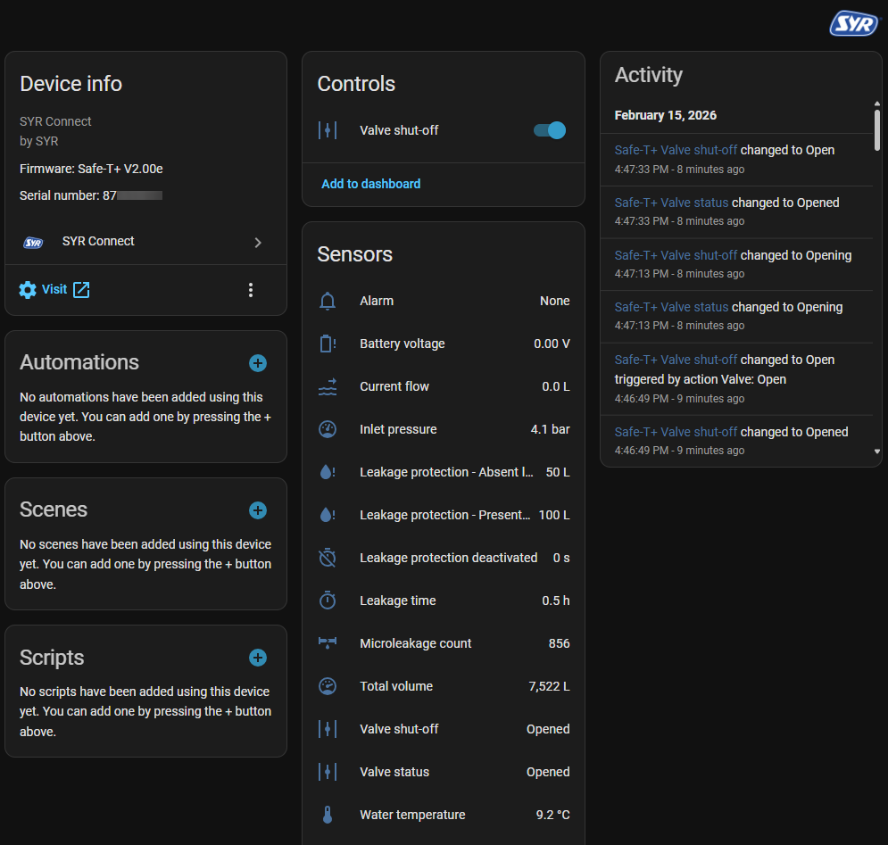

<!-- markdownlint-disable-next-line MD041 -->


# SYR Connect - integracja dla Home Assistant

[](https://github.com/alexhass/syr_connect/releases)
[](https://my.home-assistant.io/redirect/config_flow_start/?domain=syr_connect)
[](https://github.com/alexhass/syr_connect/blob/main/quality_scale.yaml)

<!-- ha-marketplace:exclude-start -->

[](https://github.com/alexhass/syr_connect/actions/workflows/hassfest.yaml)
[](https://github.com/alexhass/syr_connect/actions/workflows/hacs.yaml)
[](https://github.com/alexhass/syr_connect/actions/workflows/ci.yml)
[](https://codecov.io/gh/alexhass/syr_connect)

<!-- ha-marketplace:exclude-end -->

Ta niestandardowa integracja umożliwia sterowanie urządzeniami SYR Connect z poziomu Home Assistant. Można jej używać także z identycznymi urządzeniami innych marek. Obsługiwane są również instalacje mieszane z urządzeniami różnych marek.

| Marka | Link |
| ------ | ------ |
| comfort by sanibel | <https://comfort-by-sanibel.de/> |
| CONEL | <https://www.conel.de/> |
| DITECH | <https://www.ditech-haustechnik.de/> |
| Hansgrohe Pontos | <https://www.hansgrohe.de/> |
| mein concept | <https://www.mein-concept.de/> |
| mein Optima | <https://www.mein-optima.de/> |
| POLYGONVATRO | <https://www.polygongroup.com/de-DE/> |
| Reliance Valves | <https://www.rwc.com/brands/reliance-valves> |
| SYR | <https://www.syr.de/> |
| SYR Oceanic | <https://www.debestewaterbehandeling.be/> |
| TAKE | <https://take-bad.de/> |

## Zrzuty ekranu

Przykłady interfejsów urządzeń:




<!-- ha-marketplace:exclude-start -->

## Instalacja

[](https://my.home-assistant.io/redirect/marketplace_repository/?owner=alexhass&repository=syr_connect&category=integration)

### Marketplace (zalecane)

1. Przejść do Ustawienia > Marketplace.
2. Wyszukać „SYR Connect”.
3. Kliknąć „Zainstaluj”.
4. Uruchomić ponownie Home Assistant.

### Instalacja ręczna

1. Skopiować folder `syr_connect` do katalogu `custom_components`.
2. Uruchomić ponownie Home Assistant.

<!-- ha-marketplace:exclude-end -->

## Konfiguracja

[](https://my.home-assistant.io/redirect/config_flow_start/?domain=syr_connect)

Integracja obsługuje dwa tryby konfiguracji:

### Konfiguracja z API w chmurze (wszystkie urządzenia)

1. Przejść do Ustawienia > Urządzenia oraz usługi.
2. Kliknąć „+ Dodaj integrację”.
3. Wyszukać „SYR Connect”.
4. Wybrać „Chmura”.
5. Wprowadzić dane logowania aplikacji mobilnej:
   - **Usługa**: Aplikacja, w której skonfigurowano urządzenia
   - **Nazwa użytkownika**: Nazwa użytkownika konta w tej aplikacji
   - **Hasło**: Hasło do konta w tej aplikacji

### Konfiguracja z lokalnym API (tylko nowsze urządzenia)

Dla nowszych urządzeń z lokalnym API JSON, na przykład urządzeń NeoSoft i Trio, SafeTech Lock, TRIO Lock, AC 3200 i RSA Connect oraz ich identycznych urządzeń innych marek. Wybór modelu podczas konfiguracji zawiera wszystkie obsługiwane modele:

1. Przejść do Ustawienia > Urządzenia oraz usługi.
2. Kliknąć „+ Dodaj integrację”.
3. Wyszukać „SYR Connect”.
4. Wybrać „Lokalny”.
5. Wprowadzić dane urządzenia:
   - **Model urządzenia**: Model urządzenia (np. NeoSoft 2500 Connect)
   - **Nazwa hosta lub adres IP**: Adres IP lub nazwa hosta urządzenia (np. `192.168.178.199`)

**Uwaga**: Adres IP urządzenia jest widoczny na liście klientów DHCP routera lub w menu wyświetlacza urządzenia.

**Ważne**: Do stabilnej pracy urządzenie musi mieć **statyczny adres IP** lub **zarezerwowaną dzierżawę DHCP** (rezerwację DHCP). Jeśli adres IP urządzenia się zmieni, integracja traci połączenie. Nowy adres wprowadza się za pomocą „Ponownie skonfiguruj” w menu z trzema kropkami (⋮) wpisu. Wpis pozostaje powiązany ze swoim urządzeniem przez numer seryjny: inne urządzenie pod nowym adresem zostaje odrzucone i musi zostać dodane jako nowy wpis. Alternatywnie można użyć nazwy hosta, jeśli sieć obsługuje lokalne rozwiązywanie nazw DNS.

## Funkcje

Integracja automatycznie tworzy encje dla wszystkich urządzeń SYR Connect na koncie.

### Obsługiwane urządzenia

Ta integracja działa ze zmiękczaczami wody i urządzeniami do wykrywania wycieków firmy SYR oraz z innymi urządzeniami widocznymi w chmurze SYR Connect (za pośrednictwem odpowiedniej aplikacji mobilnej).

Przetestowane i zgłoszone jako działające:

- CONEL CLEAR PRO FILL
- CONEL CLEAR PRO Floor Sensor
- CONEL CLEAR PRO LEAKAGE PROTECTION
- CONEL CLEAR PRO SOFT
- CONEL CLEAR PRO SOFT TWIN
- concept 200 Dual Water Softener
- concept Dual Water Softener
- concept Single Water Softener
- concept SafeFloor Floor Sensor
- DITECH Dual Water Softener
- DITECH Single Water Softener
- DITECH Wireless Floor Sensor
- Optima Dual Water Softener
- Optima Single Water Softener
- Optima T2 Dual Water Softener
- Optima T2 Floor Sensor
- POLYGONVATRO Wireless Floor Sensor
- Sanibel Leak Protection Module A25
- Sanibel Softwater DUO A25
- Sanibel Softwater UNO A25
- Sanibel Wireless Floor Sensor A25
- SYR All-in-One+
- SYR LEX 1500 Connect Single (LEX10/LEX20/LEX30/LEX40/LEX60/LEX80/LEX100)
- SYR LEX Plus 10 Connect
- SYR LEX Plus 10 S Connect
- SYR LEX Plus 10 SL Connect
- SYR NeoSoft 2500 Connect
- SYR NeoSoft 5000 Connect
- SYR NeoSoft Lock Connect I
- SYR NeoSoft Lock Connect II
- SYR SafeFloor Connect
- SYR Safe-T+ Connect
- SYR SafeTech Connect
- SYR SafeTech plus Connect
- SYR SafeTech V3 Connect
- SYR SafeTech V4 Connect
- SYR TRIO DFR/LS Connect 2425
- SYR TRIO Lock Connect
- SYR Oceanic i-LEX / Limex iQ Single (L10/L12/L15/L20/L25/L30/L40/L50/L60/L70/L80/L90/L100)
- TAKE Dual Water Softener
- TAKE Single Water Softener

Inne urządzenia również są interesujące, ale mogą wymagać integracji lub przynajmniej przetestowania (prosimy o zgłoszenia):

- CONEL CLEAR PRO MULTICONTROL-KIT
- concept 200 Replacement Filter
- concept 300 Automatic Backwash RSA
- concept 300 Trio Filter with Leak Protection
- DITECH Automatic Backwash HWS/RF
- DITECH Backwash Filter Protect
- DITECH Connection Module Plus
- DITECH Hygiene Flush Box
- Hansgrohe PontosBase
- Optima T Replacement Filter
- POLYGONVATRO SafeTech Connect (sprzedawany z ubezpieczeniem budynku AXA jako „Wasserwächter”)
- RWC MultiSafe Floor Leak Sensor
- RWC MultiSafe Leak Detector Control Valve
- Sanibel Automatic Backwash System RSA A25
- SYR AC 3200 Connect
- SYR AC All-in-One 3228 Connect
- SYR CONTROLICmini
- SYR HVA
- SYR HygBox Connect
- SYR Hygiene Module (zimna / ciepła / zimna i ciepła)
- SYR Inliner-HWA 3300
- SYR IT 3000 Pendulum system
- SYR LEX 1500 Connect Alternating
- SYR LEX 1500 Connect Duplex
- SYR LEX 1500 Connect Triple
- SYR NeoDos Connect
- SYR RSA Connect
- SYR Safe-T Communication Module
- SYR Safe-T Hygiene Module
- SYR Safe-T Master / Slave
- SYR SafeTech Lock Connect
- SYR Trio LS Connect

**Uwaga**: Jeśli urządzenie jest widoczne na koncie SYR Connect, integracja je wykrywa i automatycznie tworzy encje. W przypadku „nieprzetestowanego urządzenia” udostępnienie diagnostyki pomaga znaleźć nieznane wartości i sprawdzić, czy wszystko działa zgodnie z oczekiwaniami. Dzięki temu można też rozszerzyć listę przetestowanych urządzeń.

### Nieobsługiwane urządzenia

- Urządzenia SYR Oceanic Limex SMART COMPACT/MINI/MAXI. Te urządzenia korzystają z innego portalu w chmurze (`i-lexconnect.com`) zamiast usługi w chmurze SYR Connect. Są to urządzenia Husty SaoCal sprzedawane pod inną marką.
- Urządzenia Husty SaoCal. Zobacz [husty_integration_home_assistant](https://github.com/trafopowielacz/husty_integration_home_assistant).

### Obsługiwane funkcje

#### Czujniki

Integracja zapewnia kompleksowe monitorowanie urządzeń:

#### Jakość wody i wydajność

- Monitorowanie twardości wody surowej i zmiękczonej
- Przewodność wody (µS/cm)
- Zakres twardości wody (miękka, średnia, twarda), szacowany na podstawie przewodności (rodzina SafeTech)
- Współczynnik przewodności
- Temperatura wody (°C)
- Śledzenie pozostałej wydajności zmiękczania
- Pojemność żywicy na zbiornik (do 3 zbiorników, %)
- Monitorowanie całkowitej objętości
- Wyświetlanie jednostki twardości wody

#### Informacje o regeneracji

- Stan regeneracji i wskaźnik aktywnego zbiornika (do 3 zbiorników)
- Tryb regeneracji (Standard / ECO / Power / Automatyczny)
- Liczba wykonanych regeneracji
- Znacznik czasu ostatniej regeneracji
- Ustawienia interwału regeneracji
- Harmonogram regeneracji
- Liczniki cykli i czasy

#### Zarządzanie solą

- Ilość soli w pojemnikach (1–3)
- Zapas soli (pozostałe tygodnie)
- Rezerwowa pojemność żywicy na butlę

#### Monitorowanie systemu

- Monitorowanie ciśnienia wody
- Przepływ (bieżący i chwilowy)
- Licznik przepływu (całkowite zużycie)
- Napięcie baterii i sieci
- Stan alarmów, powiadomień i ostrzeżeń (bieżący kod i ostatnie 8 wpisów historii)

#### Ochrona przed wyciekiem (LEXplus10SL / Trio DFR/LS)

- Limity objętości i czasu ochrony przed wyciekiem (profile obecności i nieobecności)
- Indeks aktywnego profilu ochrony przed wyciekiem
- Profile ochrony przed wyciekiem 1–8 (limit objętości, maksymalny czas, próg przepływu, flagi ostrzeżenia i brzęczyka)
- Licznik czasowego wyłączenia
- Próg ostrzeżenia o wycieku (%)

#### Test mikroprzecieku (Trio DFR/LS, SafeTech, SafeTech+, TRIO Lock, SafeTech Lock)

- Interwał i stan testu mikroprzecieku
- Czas trwania testu i liczba zdarzeń

#### Faza samouczenia (Trio DFR/LS, SafeTech+, TRIO Lock, SafeTech Lock)

- Pozostały i upłynięty czas samouczenia
- Przepływ i skumulowana objętość podczas samouczenia
- Ustawienia samouczenia: margines objętości i czasu, margines przepływu, minimalny przepływ

#### Czujnik podłogowy (SafeFloor)

- Bieżąca wilgotność i temperatura
- Poziom baterii (%)
- Stan alarmu

#### Filtr i płukanie zwrotne

- Typ filtra (SafeTech, SafeTech Lock, TRIO Lock, AC All-in-One 3228 Connect)
- Zawartość żelaza (rodzina LEX)
- Liczniki automatycznych i ręcznych płukań zwrotnych (automatyczne płukanie zwrotne RSA)

#### Konserwacja

- Najbliższe zaplanowane terminy konserwacji (półroczna i roczna)
- Przewidywane dzienne zużycie wody

#### Informacje o urządzeniu

- Numer seryjny
- Wersja oprogramowania sprzętowego i model
- Typ urządzenia i producent
- Informacje sieciowe (IP, MAC, brama)
- Stan połączenia Wi-Fi i siła sygnału
- Strefa czasowa (przesunięcie względem UTC)

#### Czujniki binarne

- **Brzęczyk przy alarmie**: Pokazuje, czy brzęczyk włącza się przy alarmie.
- **Ochrona przed wyciekiem**: Pokazuje, czy ochrona przed wyciekiem jest aktywna, czy wyłączona.
- **Test zaworu**: Pokazuje, czy trwa test zaworu.
- **Sprawdzanie oprogramowania sprzętowego**: Pokazuje, czy dostępne jest nowe oprogramowanie sprzętowe (sprawdzane przy uruchomieniu i co 6 godzin).
- **Czas letni**: Pokazuje, czy urządzenie automatycznie przełącza się na czas letni.
- **Czujnik temperatury**, **Czujnik ciśnienia**, **Czujnik przewodności**: Pokazują, czy czujnik pomiarowy jest aktywny, czy wyłączony.
- **Monitorowanie czujnika podłogowego**: Pokazuje, czy monitorowanie czujników podłogowych jest włączone.

#### Przyciski (akcje)

- **Regeneruj teraz**: Uruchomienie natychmiastowej regeneracji. Jest odrzucane, gdy trwa regeneracja.
- **Resetuj alarm**: Usunięcie aktywnych komunikatów alarmowych.
- **Resetuj powiadomienie**: Usunięcie powiadomień.
- **Resetuj ostrzeżenie**: Usunięcie ostrzeżeń.
- **Uruchom test mikroprzecieku**: Uruchomienie testu mikroprzecieku. Zawór pozostaje zamknięty przez około 4 minuty, a pobieranie wody w trakcie testu daje wynik negatywny (tylko lokalne API).
- **Płukanie ręczne (woda zimna)**, **Płukanie ręczne (woda ciepła)**: Uruchomienie ręcznego płukania przewodu wodnego (moduł higieniczny).

#### Przełączniki

- **Brzęczyk przy alarmie**: Włączenie lub wyłączenie brzęczyka przy alarmie.
- **Zezwalaj na zmianę profilu na urządzeniu**: Zezwolenie lub zablokowanie zmiany profilu ochrony przed wyciekiem przyciskiem na urządzeniu.
- **Tryb napełniania**: Włączenie lub wyłączenie automatycznego napełniania (CLEAR PRO FILL All-in-One, AC All-in-One 3228 Connect, AC 3200 Connect i jego identyczne urządzenia innych marek, All-in-One+).
- **Pierwsze napełnienie**: Uruchomienie lub zatrzymanie pierwszego napełnienia (CLEAR PRO FILL All-in-One, AC All-in-One 3228 Connect, AC 3200 Connect i jego identyczne urządzenia innych marek, All-in-One+).
- **Ręczne napełnianie**: Uruchomienie lub zatrzymanie ręcznego napełniania (All-in-One+).
- **Automatyczne płukanie zwrotne**: Włączenie lub wyłączenie automatycznego płukania zwrotnego (automatyczne płukanie zwrotne RSA).
- **Przypomnienie o płukaniu zwrotnym**: Włączenie lub wyłączenie przypomnienia o płukaniu zwrotnym (automatyczne płukanie zwrotne RSA).
- **Płukanie stagnacyjne**, **Płukanie temperaturowe**, **Płukanie okresowe**: Włączenie lub wyłączenie trzech funkcji płukania (HygBox).

#### Pola wyboru (konfiguracja)

- **Czas regeneracji**: Ustawienie dziennej godziny regeneracji (w odstępach 15-minutowych).
- **Aktywny profil ochrony przed wyciekiem**: Wybór aktywnego profilu ochrony przed wyciekiem (w urządzeniach z wieloma profilami).
- **Ilość soli w pojemniku 1–3**: Ustawienie ilości soli na pojemnik (zależnie od modelu, do 3 pojemników).
- **Interwał regeneracji**: Ustawienie częstotliwości regeneracji (zależnie od modelu: do 3, 4 lub 99 dni).
- **Orientacja wyświetlacza**: Ustawienie orientacji wyświetlacza (0 / 90 / 180 / 270 stopni, w urządzeniach z wyświetlaczem).
- **Język urządzenia**: Ustawienie języka wyświetlacza urządzenia: niemiecki, angielski, hiszpański, włoski lub polski (SafeTech).
- **Tryb regeneracji**: Wybór Standard / ECO / Power / Automatyczny (w urządzeniach, które to obsługują).
- **Twardość wody surowej**, **Twardość wody zmiękczonej**: Ustawienie twardości wody surowej i zmiękczonej (rodzina LEX, CLEAR PRO FILL All-in-One, AC All-in-One 3228 Connect, AC 3200 Connect i jego identyczne urządzenia innych marek, All-in-One+). Jednostka odpowiada jednostce twardości ustawionej w urządzeniu (°dH, °fH, °e, mg/l CaCO₃, ppm, mmol/l lub mval/l).
- **Uzdatnianie wody i napełnianie** (CLEAR PRO FILL All-in-One, AC All-in-One 3228 Connect, AC 3200 Connect i jego identyczne urządzenia innych marek, All-in-One+): Rozmiar i typ wkładu, twardość wody zmiękczonej lub maksymalna przewodność na wyjściu (zależnie od wkładu), okres napełniania, liczba cykli napełniania, maksymalny czas i ilość napełniania, ciśnienie docelowe, próg ostrzeżenia o pozostałej pojemności, maksymalna objętość i czas pierwszego napełnienia.
- **Czujnik podłogowy** (SafeFloor): Czas trwania alarmu, minimalne i maksymalne progi wilgotności i temperatury („Wył.” wyłącza próg), interwał pomiarów i interwał synchronizacji ustawień.
- **Płukanie higieniczne** (HygBox): Rodzaj wody, czas stagnacji i objętość płukania, temperatura początkowa i końcowa, maksymalny czas płukania i liczba płukań na dzień, interwał i objętość płukania okresowego, interwał synchronizacji ustawień.
- **Płukanie higieniczne** (moduł higieniczny, Safe-T Hygiene Module): Czas stagnacji, interwał płukania, limit temperatury, maksymalny czas i maksymalna objętość płukania przewodu wody zimnej i przewodu wody ciepłej.
- **Dozowanie** (NeoDos Connect): Rozmiar kanistra, płyn dozujący i tryb pracy.
- **Płukanie zwrotne** (automatyczne płukanie zwrotne RSA): Interwał płukania zwrotnego i interwał przypomnienia o płukaniu zwrotnym (1–365 dni).
- **Ochrona przed wyciekiem** (Safe-T+): Poziom ochrony przed wyciekiem przy obecności i nieobecności (poziom przy nieobecności przełącza na profil nieobecności, „Wyłączony” z powrotem na profil obecności), czas wycieku i tymczasowa dezaktywacja ochrony przed wyciekiem.

#### Sterowanie zaworem

- **Zawór odcinający**: Sterowanie głównym zaworem odcinającym wodę.
  - Otwieranie i zamykanie zaworu.
  - Monitorowanie bieżącego położenia i stanu zaworu.
  - Integracja z automatyzacjami wykrywania wycieków w celu automatycznego odcięcia.

#### Aktualizacja oprogramowania sprzętowego

- **Aktualizacja oprogramowania sprzętowego**: Pokazuje, czy dostępne jest nowe oprogramowanie sprzętowe, i instaluje je. Urządzenie musi być połączone z internetem. Urządzenie nie podaje numeru nowej wersji.

### Tryby API

Integracja obsługuje dwa tryby API:

#### API w chmurze (oparte na XML)

- **Obsługiwane przez**: Wszystkie urządzenia SYR Connect
- **Połączenie**: Przez usługę w chmurze SYR Connect
- **Uwierzytelnianie**: Nazwa użytkownika i hasło konta SYR Connect
- **Zalety**: Działa ze wszystkimi modelami urządzeń, dostęp zdalny z dowolnego miejsca
- **Wymagania**: Połączenie z internetem, konto SYR Connect

#### Lokalne API (oparte na JSON)

- **Obsługiwane przez**: Nowsze modele z wbudowanym lokalnym API, na przykład NeoSoft, Trio DFR/LS, TRIO Lock, SafeTech Lock, AC 3200, RSA, Pontos Base, All-in-One+, HygBox i nowsze warianty SafeTech, także innych marek. Wybór modelu podczas konfiguracji zawiera wszystkie obsługiwane modele.
- **Połączenie**: Bezpośrednio z urządzeniem przez sieć lokalną (port 5333).
- **Uwierzytelnianie**: Dane logowania nie są wymagane.
- **Zalety**: Brak zależności od internetu, krótsze czasy odpowiedzi, brak limitów zapytań chmury.
- **Wymagania**: Urządzenie musi znajdować się w tej samej sieci co Home Assistant i wymaga statycznego adresu IP lub nazwy hosta.

Tryb API wybiera się podczas konfiguracji (Chmura lub Lokalny).

## Jak aktualizowane są dane

Integracja odpytuje API urządzenia w regularnych odstępach czasu (domyślnie: 60 sekund). Proces aktualizacji zależy od trybu API:

### Proces aktualizacji z API w chmurze

1. **Logowanie**: Uwierzytelnia się w API w chmurze SYR Connect przy użyciu danych logowania.
2. **Wykrywanie urządzeń**: Pobiera wszystkie projekty i urządzenia powiązane z kontem, przy uruchomieniu, a następnie co 30 minut. Urządzenie usunięte z konta zostaje usunięte z Home Assistant razem ze swoimi encjami.
3. **Aktualizacje stanu**: Dla każdego urządzenia pobiera bieżący stan ze wszystkimi wartościami czujników.
4. **Aktualizacje encji**: Aktualizuje wszystkie encje Home Assistant najnowszymi wartościami.

### Proces aktualizacji z lokalnym API

1. **Aktualizacje stanu**: Pobiera stan urządzenia bezpośrednio z lokalnego punktu końcowego.
2. **Aktualizacje encji**: Aktualizuje wszystkie encje Home Assistant najnowszymi wartościami.

Lokalne API jest szybsze i nie zależy od połączenia z internetem, dzięki czemu jest bardziej niezawodne przy monitorowaniu w czasie rzeczywistym i w automatyzacjach.

Jeśli aktualizacja tymczasowo się nie powiedzie (np. przekroczenie limitu czasu, konserwacja chmury lub niepełna odpowiedź), encje zachowują ostatnie wartości, a błąd jest zapisywany w dzienniku. Encje stają się niedostępne tylko wtedy, gdy chmura zgłasza urządzenie jako offline. Pozostają niedostępne, dopóki urządzenie ponownie nie wyśle pełnego stanu.

Dopóki nie można pobrać żadnych danych, integracja odpytuje rzadziej: interwał podwaja się po każdej nieudanej aktualizacji, maksymalnie do 15 minut. Pierwsza udana aktualizacja przywraca skonfigurowany interwał.

Jeśli przez ponad 1 godzinę nie można pobrać danych, awaria nie jest już traktowana jako tymczasowa: dotknięte encje stają się niedostępne, a w **Ustawienia** → **Naprawy** wyświetlany jest komunikat. Oba znikają, gdy tylko dane zostaną ponownie pobrane.

### Historia pomiarów SafeFloor

SafeFloor regularnie mierzy temperaturę i wilgotność, ale wysyła pomiary do chmury tylko co kilka dni, dlatego jego czujniki pokazują płaską linię, po której następuje skok. Integracja co 12 godzin pobiera z chmury pojedyncze pomiary i zapisuje je jako statystyki nazwane od czujników (np. „Pralnia Temperatura”). Aby zobaczyć rzeczywistą krzywą, do pulpitu dodaje się kartę:

1. Otworzyć pulpit i wybrać **Edytuj pulpit** w prawym górnym rogu.
2. Wybrać **Dodaj kartę**, wpisać `Statistics` w polu **Szukaj kart** i wybrać **Wykres statystyk**.
3. Wybrać **Pokaż edytor kodu**, zastąpić tekst jednym z poniższych fragmentów i wybrać **Zapisz**.
4. Wybrać **Gotowe**.

`123456789` zastępuje się numerem seryjnym SafeFloor. Na każdy pomiar potrzebna jest jedna karta.

Temperatura:

```yaml
type: statistics-graph
title: Temperatura
chart_type: line
period: hour
days_to_show: 14
stat_types:
  - mean
entities:
  - syr_connect:123456789_getcel_history
```

Wilgotność:

```yaml
type: statistics-graph
title: Wilgotność
chart_type: line
period: hour
days_to_show: 14
stat_types:
  - mean
entities:
  - syr_connect:123456789_gethmd_history
```

Chmura przechowuje tylko pomiary z ostatnich 6 dni. Interwał synchronizacji czujnika musi wynosić 6 dni lub mniej, w przeciwnym razie pomiary zostaną utracone. Statystyki są usuwane razem z urządzeniem.

### Znane ograniczenia

- **Zależność od chmury**: API w chmurze wymaga aktywnego połączenia z internetem i działającej usługi w chmurze.
- **Interwał aktualizacji**: API w chmurze pozwala na interwał aktualizacji wynoszący co najmniej 60 sekund, lokalne API co najmniej 10 sekund.
- **Ograniczony dostęp do zapisu**: Obsługiwane są zmiany konfiguracji (czas regeneracji, ilości soli, interwały) i akcje sterujące (regeneracja, sterowanie zaworem), ale niektóre zaawansowane ustawienia mogą być dostępne tylko w aplikacji SYR Connect.
- **Obsługa lokalnego API**: Nie każdy model udostępnia lokalne API JSON. LEX 1500, LEXplus, i-LEX, Safe-T, SafeFloor, HVA, moduły higieniczne i starsze warianty SafeTech wymagają dostępu przez API w chmurze.

## Przypadki użycia i przykłady

### Przykłady automatyzacji

Przykłady używają składni YAML z `configuration.yaml`. We wszystkich przykładach `<serial_number>` zastępuje się numerem seryjnym urządzenia, a `<device_name>` nazwą urządzenia aplikacji mobilnej w Home Assistant.

#### Ostrzeżenie o niskim poziomie soli

Powiadomienie, gdy zapas soli się kończy:

```yaml
automation:
  - alias: "SYR: Ostrzeżenie o niskim poziomie soli"
    triggers:
      - trigger: numeric_state
        entity_id: sensor.syr_connect_<serial_number>_getss1
        below: 2  # Soli wystarczy na mniej niż 2 tygodnie
    actions:
      - action: notify.mobile_app_<device_name>
        data:
          title: "Zmiękczacz wody"
          message: "Niski zapas soli - pozostało mniej niż 2 tygodnie"
```

#### Dzienny raport regeneracji

Dzienne podsumowanie regeneracji, pozostałej wydajności i zapasu soli:

```yaml
automation:
  - alias: "SYR: Dzienny raport regeneracji"
    triggers:
      - trigger: time
        at: "20:00:00"
    actions:
      - action: notify.mobile_app_<device_name>
        data:
          title: "Dzienny raport zmiękczacza wody"
          message: >
            Regeneracje (łącznie): {{ states('sensor.syr_connect_<serial_number>_getnor') }}
            Pozostała wydajność: {{ states('sensor.syr_connect_<serial_number>_getres') }} L
            Zapas soli: {{ states('sensor.syr_connect_<serial_number>_getss1') }} tygodni
```

#### Powiadomienie o alarmie

Natychmiastowe powiadomienie, gdy urządzenie zgłasza alarm:

```yaml
automation:
  - alias: "SYR: Powiadomienie o alarmie"
    triggers:
      - trigger: template
        value_template: >
          {{ states('sensor.syr_connect_<serial_number>_getala')
             not in ['no_alarm', 'unknown', 'unavailable'] }}
    actions:
      - action: notify.mobile_app_<device_name>
        data:
          title: "⚠️ Alarm SYR"
          message: "Bieżący alarm: {{ states('sensor.syr_connect_<serial_number>_getala') }}"
          data:
            priority: high
```

#### Monitorowanie przepływu wody

Ostrzeżenie o nietypowo wysokim przepływie wody przez kilka minut (możliwy wyciek):

```yaml
automation:
  - alias: "SYR: Ostrzeżenie o wysokim przepływie"
    triggers:
      - trigger: numeric_state
        entity_id: sensor.syr_connect_<serial_number>_getflo
        above: 1200  # Przepływ powyżej 1200 l/h (20 l/min)
        for:
          minutes: 5
    actions:
      - action: notify.mobile_app_<device_name>
        data:
          title: "Wykryto wysoki przepływ wody"
          message: "Nietypowy przepływ wody - możliwy wyciek"
```

#### Czujnik wycieku: zamknięcie zaworu wody

Zamyka zawór odcinający wodę SYR standardową akcją `valve.close`, gdy czujnik wycieku wykryje wodę. Identyfikatory encji zastępuje się identyfikatorami używanymi w instalacji. Ta automatyzacja może stać się krytyczną akcją bezpieczeństwa, dlatego musi zostać bardzo starannie przetestowana.

```yaml
automation:
  - alias: "SYR: Zamknięcie zaworu przy wycieku"
    triggers:
      - trigger: state
        entity_id: binary_sensor.house_leak_sensor
        to: "on"
    actions:
      - action: valve.close
        target:
          entity_id: valve.syr_connect_<serial_number>_getab
      - action: notify.mobile_app_<device_name>
        data:
          title: "SYR: Wykryto wyciek - zawór zamknięty"
          message: "Wykryto wyciek wody - zawór odcinający wodę SYR został zamknięty automatycznie."
```

#### Regeneracja w weekend

Uruchamia regenerację w soboty i niedziele o 03:00:

```yaml
automation:
  - alias: "SYR: Regeneracja w weekend"
    triggers:
      - trigger: time
        at: "03:00:00"
    conditions:
      - condition: time
        weekday:
          - sat
          - sun
    actions:
      - action: button.press
        target:
          entity_id: button.syr_connect_<serial_number>_setsir
```

## Opcje konfiguracji

### Interwał aktualizacji

Dane są domyślnie aktualizowane co 60 sekund. Interwał ustawia się w opcjach integracji: co najmniej 60 sekund dla chmury, co najmniej 10 sekund dla urządzeń lokalnych i maksymalnie 600 sekund w obu przypadkach.

1. Otworzyć Ustawienia > Urządzenia oraz usługi.
2. Otworzyć integrację SYR Connect.
3. Wybrać „Konfiguruj”.
4. Dostosować interwał aktualizacji (w sekundach).

## Usuwanie

Aby usunąć integrację z Home Assistant:

1. Przejść do Ustawienia > Urządzenia oraz usługi.
2. Znaleźć integrację SYR Connect.
3. Kliknąć menu z trzema kropkami (⋮).
4. Wybrać „Usuń”.
5. Potwierdzić usunięcie.

Wszystkie powiązane urządzenia i encje zostaną usunięte automatycznie.

## Rozwiązywanie problemów

### Pobieranie diagnostyki

W przypadku problemów pomocna jest diagnostyka wpisu integracji. Zawiera ona dane wszystkich urządzeń wpisu:

1. Otworzyć Ustawienia > Urządzenia oraz usługi.
2. Otworzyć integrację SYR Connect.
3. Otworzyć menu z trzema kropkami (⋮) wpisu (konto lub urządzenie lokalne).
4. Wybrać „Pobierz diagnostykę”.

Hasła, nazwy użytkowników, dane sesji, numer kodowy urządzenia, adresy IP, bramy i nazwa sieci Wi-Fi są usuwane z pliku, a numer seryjny jest maskowany.

### Dzienniki debugowania

Włączanie i wyłączanie dziennika debugowania opisano w [docs/howto-debugging.md](docs/howto-debugging.md) (w języku angielskim).

### Połączenie nie działa

- **Sprawdzenie danych logowania**: Należy sprawdzić nazwę użytkownika i hasło aplikacji SYR Connect.
- **Test aplikacji**: Logowanie do aplikacji mobilnej SYR Connect musi działać na tym samym koncie.
- **Sprawdzenie dzienników**: Przejść do Ustawienia > System > Logi i wyszukać błędy „syr_connect”.
- **Problemy z siecią**: Home Assistant musi mieć dostęp do internetu.

### Błędy uwierzytelniania

W przypadku błędów „Authentication failed”:

1. Sprawdzić dane logowania.
2. Integracja poprosi o ponowne uwierzytelnienie.
3. Przejść do Ustawienia > Urządzenia oraz usługi.
4. Kliknąć „Uwierzytelnij” przy integracji SYR Connect.
5. Ponownie wprowadzić dane logowania.

Ponowne uwierzytelnienie i „Ponownie skonfiguruj” zmieniają tylko hasło konta. Inna nazwa użytkownika to inne konto: zostaje tam odrzucona i musi zostać dodana jako nowy wpis.

### Nie znaleziono urządzeń

- **Konfiguracja aplikacji**: Urządzenia muszą być prawidłowo skonfigurowane w aplikacji SYR Connect.
- **Dostęp do konta**: Konto musi być tym, w którym skonfigurowano urządzenia.
- **Stan urządzeń**: Należy sprawdzić, czy urządzenia są online w aplikacji SYR Connect.
- **Dzienniki**: Należy sprawdzić dzienniki Home Assistant pod kątem konkretnych komunikatów o błędach.

### Encje są wyświetlane jako niedostępne

- **Urządzenie offline**: Chmura zgłasza urządzenie jako offline. Należy sprawdzić zasilanie i połączenie sieciowe urządzenia.
- **Aplikacja SYR Connect**: Urządzenie musi być wyświetlane jako online w aplikacji SYR Connect.
- **Ponownie online**: Encje stają się ponownie dostępne, gdy tylko urządzenie wyśle pełny stan.

- **Brak połączenia przez ponad 1 godzinę**: Przez ponad 1 godzinę nie udało się pobrać danych z chmury ani z urządzenia. W **Ustawienia** → **Naprawy** wyświetlany jest komunikat. Należy sprawdzić połączenie z internetem i stan chmury SYR Connect.
- **Problem z siecią**: Jeśli nie udało się rozwiązać nazwy hosta lub otworzyć połączenia, komunikat wskazuje sieć jako przyczynę. Należy sprawdzić połączenie sieciowe i ustawienia DNS Home Assistant, a w przypadku urządzenia lokalnego także jego adres IP.

Tymczasowe problemy z połączeniem lub usługą w chmurze nie powodują niedostępności encji. Encje zachowują ostatnie wartości, a błąd jest zapisywany w dzienniku.

### Wysokie użycie procesora lub pamięci

- **Zwiększenie interwału aktualizacji**: Ustawić wyższą wartość (np. 120–300 sekund) w opcjach integracji.
- Zmniejsza to liczbę wywołań API i obciążenie systemu.

<!-- ha-marketplace:exclude-start -->

## Zależności

Integracja wymaga następujących pakietów Python:

- `pycryptodomex>=3.19.0,<4.0`: Do szyfrowania i odszyfrowywania AES
- `defusedxml>=0.7.1,<1.0`: Do bezpiecznego przetwarzania XML (zapobiega atakom XXE)

**Uwaga**: Integracja używa `defusedxml` do bezpiecznego przetwarzania XML oraz `pycryptodomex` (a nie `pycryptodome`), aby uniknąć konfliktów z wbudowanymi bibliotekami kryptograficznymi Home Assistant.

Home Assistant instaluje pakiety **automatycznie**, gdy:

1. Integracja zostanie dodana przez interfejs użytkownika.
2. Home Assistant zostanie uruchomiony ponownie po instalacji.

Szczegółowe wymagania systemowe i rozwiązywanie problemów opisano w [REQUIREMENTS.md](REQUIREMENTS.md) (w języku angielskim).

<!-- ha-marketplace:exclude-end -->

## Zastrzeżenie

### WAŻNE: Przeczytać przed użyciem integracji

Ta integracja steruje systemami uzdatniania wody i odcinania wody. Nieprawidłowa konfiguracja lub błędnie działające automatyzacje mogą doprowadzić do zalania, awarii systemu lub szkód materialnych.

- **Użycie na własne ryzyko**: To oprogramowanie jest dostarczane „tak, jak jest”, bez jakiejkolwiek gwarancji.
- **Dokładne testy**: Automatyzacje należy zawsze testować w bezpiecznych warunkach przed ich uruchomieniem.
- **Systemy krytyczne**: Automatyzacje sterujące zaworem mogą odciąć całe zasilanie wodą i muszą być starannie przetestowane.
- **Brak odpowiedzialności**: Autorzy i współtwórcy nie ponoszą odpowiedzialności za jakiekolwiek szkody, zalania, szkody materialne ani inne problemy wynikające z użycia tej integracji.
- **Zależność od chmury**: Ta integracja opiera się na usłudze w chmurze SYR Connect, której dostępność nie jest gwarantowana.
- **Plan awaryjny**: Na wypadek awarii systemu musi istnieć alternatywny dostęp do zaworu odcinającego wodę.

Instalacja i używanie tej integracji oznacza przyjęcie tych zagrożeń do wiadomości i zgodę na odpowiedzialne korzystanie z niej.

## Licencja

Apache License 2.0, zobacz [LICENSE](LICENSE)

## Podziękowania

- Inspiracją był adapter [ioBroker.syrconnectapp](https://github.com/TA2k/ioBroker.syrconnectapp) autorstwa TA2k.
- Serdeczne podziękowania dla zespołu SYR IoT-Development-Team za udostępnienie logotypów.
